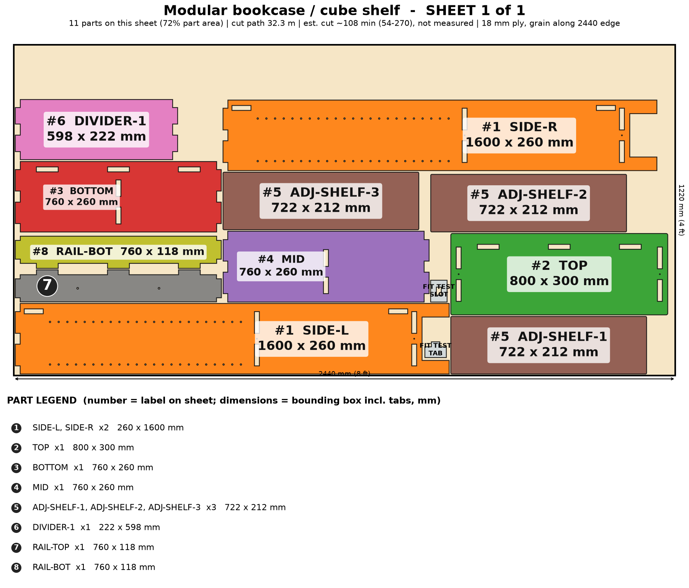

# Modular Bookcase / Cube Shelf

Open shelving cut to your wall: adjustable shelves, cube bays, raised for the robot vacuum, with a cleat rail and anti-tip anchor.

> Planning numbers are ESTIMATES / ASSUMPTIONS. Machine times are estimates (sourced range, not measured; see ../CUT-SPEED-RESEARCH.md). Run the fit-test coupon (on sheet 1) before cutting a full sheet.

## Size
Overall 800 W x 300 D x 1600 H mm. 1 sheet(s) of 4x8 (1220 x 2440 mm) 18 mm ply, cut path 32.3 m.

## Parameters (edit `PARAMS` at the top of `model.py`)
| Parameter | Default | Sane limits |
|---|---|---|
| `width` | 800.0 | 400-1000 mm |
| `height` | 1600.0 | 600-2000 mm |
| `depth` | 300.0 | 220-450 mm (>= 0.15 x height) |
| `thickness` | 18.0 | 17.5-19 mm |
| `clearance` | 0.1 | 0.0-0.2 mm |
| `plinth` | 100.0 | 90-150 mm (0 = floor standing) |
| `mid_shelf_z` | 700.0 | bottom bay >=250, top bay >=250 mm |
| `adj_shelves` | 3 | 0-8 |
| `dividers` | 1 | 0-3 |
| `pin_hole` | 5.0 | 5.0 or 6.0 mm |
| `pin_pitch` | 32.0 | 25-50 mm |

Regenerate everything with `cd furniture-v2 && /workspace/venv-egg/bin/python run.py bookcase` (writes DXFs, sheet PNGs, assembly.png, parts.json, plan.json, checks.txt). The run also builds two stress variants of the parameters and checks them.

## Joinery
Through-tab joints, slot = tab + 0.1 mm each way; #8 screws with 3.0 mm pilots; Titebond III glue with the screws acting as clamps; 6 mm minimum spacing between nested parts.

Rear rails leave a 20 mm recess for an aluminum Z-bar cleat; 2 anti-tip strap holes in the top rail (required: tall piece). Adjustable shelves ride on 5 mm pin holes at 32 mm pitch. Optional thin back panel is NOT modeled or nested.

## Cut sheets
### Sheet 1  (`bookcase-nest-sheet1-1220x2440.dxf`, `sheet-1.png`)

Parts: TOP 800x300, SIDE-L 260x1600, SIDE-R 260x1600, BOTTOM 760x260, MID 760x260, RAIL-TOP 760x118, RAIL-BOT 760x118, DIVIDER-1 222x598, ADJ-SHELF-1 722x212, ADJ-SHELF-2 722x212, ADJ-SHELF-3 722x212

## Build stages (471 min total, estimate)
| # | Stage | min | What |
|---|---|---|---|
| 1 | Cut the sheets | 216 | Load sheet 1 on the honeycomb bed, run the fit-test coupon first (slot = tab + 0.1 mm), then cut sheet 1 and sheet 2 from the DXFs (CUT layer). 1 sheet(s), 32 m of cut path; keep the air assist on and the cut order inside-out (holes and slots first). |
| 2 | Remove char and sand | 60 | Pop parts out, brush the char from the cut edges, 120 then 180 grit on faces and edges; ease the top and shelf corners. Wipe with a damp rag. |
| 3 | Dry fit | 15 | Stand SIDE-L and SIDE-R, push BOTTOM and MID into their slots, then TOP, then the two rails. Check square, check each tab ends flush with the outside face. No glue yet. |
| 4 | Finish the loose parts first | 45 | Seal / oil all 3 ADJ-SHELF boards and the inside faces before glue-up (glue will not stick over finish, so mask the tabs and slots). |
| 5 | Glue-up (Titebond III) | 30 | Lay SIDE-L flat. Glue and tap in BOTTOM, MID, the 1 divider(s), RAIL-BOT and RAIL-TOP, then fit SIDE-R and clamp. Last: seat TOP on all tabs. Wipe squeeze-out at once. Work time about 10 minutes, so do it in two halves if alone. |
| 6 | Screw-clamp the joints | 15 | 6 #8 screws (3.0 mm pilots are already cut): #8 x 1-1/2 in through each side face into the BOTTOM and MID edges, and down through the TOP into the side edges; countersink and plug the 4 top screws. Square the case while the glue sets. |
| 7 | Cleat and anti-tip anchor | 25 | Screw the unit half of an aluminum Z-bar (1 in) across the rear face of RAIL-TOP (it sits in the 20 mm rear recess). Mount the wall half level into studs. ALWAYS also fit an anti-tip strap: screw it through one of the two 6 mm holes in RAIL-TOP into a stud. Required on every unit above 900 mm tall. |
| 8 | Finish | 40 | Two coats of water-based poly or hardwax oil, 180-grit between coats; 24 h to cure before packing. |
| 9 | Shelf pins, test, pack | 25 | Press in the shelf pins (rows at [928.0, 1152.0, 1376.0] mm above the floor; 23 pin rows available at 32 mm pitch), load-test with 20 kg per shelf, then flat-pack: 1 sheets of parts in one 1.3 x 0.4 x 0.25 m box with corner guards. |

## Materials and hardware
Sheet: 18 mm (3/4 in) birch or Baltic-birch plywood, 4 x 8 ft (1220 x 2440 mm) x 1

| Item | Qty | Unit $ (est.) | Note |
|---|---|---|---|
| Shelf pins, 5 mm, steel/brass (pack of 24) | 1 | 5.0 | 4 per adjustable shelf |
| #8 x 1-1/2 in wood screws | 6 | 0.06 | counts from the model; 3.0 mm pilots cut in the parts |
| Aluminum Z-bar French cleat, 24-36 in pair | 1 | 12.0 | optional wall-hang; laser cannot cut the 45 deg bevel |
| Anti-tip furniture strap kit (ASTM F3096 style) | 1 | 6.0 | mandatory on tall units |
| Wood plugs / filler for top screws | 1 | 2.0 |  |
| Felt/rubber foot pads | 4 | 0.4 | under the 4 feet |

Glue: Titebond III, about 4 oz. Finish: water-based poly or hardwax oil, 2 coats (about $12).

## Profit estimate (ESTIMATES / ASSUMPTIONS)
All dollar figures are planning ESTIMATES / ASSUMPTIONS, not quotes, not guaranteed. Sheet prices: 4x8 ft 18 mm birch plywood $70-110, basic plywood $55-75 (assumption). Machine time uses a sourced RANGE for a 120 W diode on 18 mm ply (low 120 / typical 300 / high 600 mm/min effective, i.e. after multiple passes; see CUT-SPEED-RESEARCH.md); ACMER publishes no 18 mm ply feed rate, so none of it is measured on this machine. Machine wear/electricity $1.70 per machine-hour (assumption). Labor valued at $25/h for the "after labor" line only. Marketplace fees 10% (assumption, e.g. Etsy-style).

Price band source: SHORTLIST.md: custom plywood bookcase target $180-$450 (estimate); Etsy plywood bookcases $135-$330; Amazon cube shelf ~$42 [third-party estimates]

| | Low | Mid | High |
|---|---|---|---|
| Price | $180 | $315 | $450 |
| COGS (sheets at mid + hardware + finish + packaging + machine wear) | $148 | $148 | $148 |
| Gross margin | $32 (18%) | $167 (53%) | $302 (67%) |
| Gross margin if you absorb shipping (est. $55) | $-23 | $112 | $247 |
| Net after 10% fees and labor | $-43 | $78 | $200 |

### Machine time and profit per machine hour (ESTIMATE, at the mid price; includes 15 min/sheet of load, focus and unload, rapid travel between 140 contours)
| Scenario | Effective rate | Machine hours per unit | COGS | Gross margin | Gross margin per machine hour | Net after fees+labor per machine hour |
|---|---|---|---|---|---|---|
| Diode, slow case | 120 mm/min (5 pass x 600 mm/min) | 4.9 | $152 | $163 | $33 | $15 |
| Diode, typical | 300 mm/min (4 pass x 1200 mm/min) | 2.2 | $148 | $167 | $77 | $36 |
| Diode, best case | 600 mm/min (2 pass x 1200 mm/min) | 1.2 | $146 | $169 | $138 | $66 |
| Commercial CO2 300-600 W (sourced) | 600 mm/min (1 pass x 600 mm/min) | 1.0 | $152 | $163 | $165 | $75 |
| What-if 10x faster than diode typical (assumption) | x10 on diode typical cut+travel | 0.3 | $146 | $169 | $603 | $285 |
| What-if 20x faster (assumption) | x20 on diode typical cut+travel | 0.2 | $145 | $170 | $942 | $448 |

ESTIMATE: 2.2 h (low-speed case 4.9 h, best case 1.2 h) of machine time per unit for 32 m of cut path in 1 sheet(s) on a 120 W diode, 18 mm plywood. Machine time, not material, is still the limit on profit per hour, but a single test cut on scrap will replace this range with a real number.

ASSUMPTION. Sourced case: 300-600 W CO2 flatbed, single pass at ~600 mm/min (vendor 480-720), 60 m/min rapids, 5 min/sheet, $8/h operating cost. What-if cases: a machine 10x / 20x faster than the diode mid cut+travel time (not sourced for 18 mm ply).

Sources and method: ../CUT-SPEED-RESEARCH.md.

## Safety
- Anchor to a wall stud with an anti-tip strap on every unit (ASTM F3096 style); mandatory above 900 mm.
- Not a clothing-storage unit (STURDY Act applies to dressers >= 27 in); not a children's product (no CPSIA testing).
- Rated target 20 kg per 800 mm shelf (UNVERIFIED - load test one shelf to 40 kg before selling).
- Keep depth >= 0.15 x height; heavy items low.

## Unverified / caveats
- Machine time is an estimate (120 W diode on 18 mm ply, sourced range, not measured on this machine); cut time and profit/hour depend on it.
- Shelf load rating and deflection not tested (18 mm ply, 800 mm span).
- Pin-hole size depends on the pin you buy.
- Optional 1/4 in back panel not modeled or nested; rails give racking strength only with glue.
- Price band is an estimate from SHORTLIST.md.

## Verification
See `checks.txt` (assembled-model overlap/containment, nest overlap, DXF read-back).
