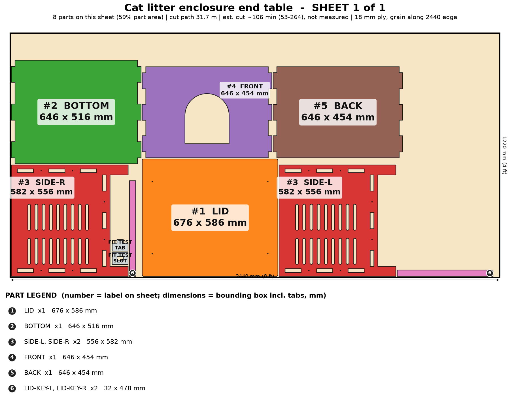

# Cat Litter Enclosure End Table

Hide the litter box in an end table: cut around your litter box, arch cat door, vented sides, a lift-off lid for a lamp or plant, and raised so the robot vacuum goes underneath.

> Planning numbers are ESTIMATES / ASSUMPTIONS. Machine times are estimates (sourced range, not measured; see ../CUT-SPEED-RESEARCH.md). Run the fit-test coupon (on sheet 1) before cutting a full sheet.

## Size
Overall 676 W x 586 D x 600 H mm. 1 sheet(s) of 4x8 (1220 x 2440 mm) 18 mm ply, cut path 31.7 m.

## Parameters (edit `PARAMS` at the top of `model.py`)
| Parameter | Default | Sane limits |
|---|---|---|
| `box_w` | 560.0 | 400-700 mm (litter box length) |
| `box_d` | 430.0 | 330-550 mm (litter box depth) |
| `height` | 600.0 | 520-700 mm |
| `entry_w` | 220.0 | 170-280 mm (<= interior width - 120) |
| `entry_h` | 250.0 | 200-320 mm (>= door width) |
| `sill` | 70.0 | 40-100 mm |
| `thickness` | 18.0 | 17.5-19 mm |
| `clearance` | 0.1 | 0.0-0.2 mm |
| `plinth` | 90.0 | 90-150 mm |
| `vents` | 1 | 0 or 1 |

Regenerate everything with `cd furniture-v2 && /workspace/venv-egg/bin/python run.py cat-enclosure` (writes DXFs, sheet PNGs, assembly.png, parts.json, plan.json, checks.txt). The run also builds two stress variants of the parameters and checks them.

## Joinery
Through-tab joints, slot = tab + 0.1 mm each way; #8 screws with 3.0 mm pilots; Titebond III glue with the screws acting as clamps; 6 mm minimum spacing between nested parts.

Interior = litter box + 50 mm each way. FRONT carries the arch cat door; both sides are vented. The LID lifts off (two LID-KEY strips glued under it locate it inside the walls). FRONT and BACK sit 20 mm in from the side edges so every slot is a closed hole. Seal the inside; no French cleat (heavy, wet).

## Cut sheets
### Sheet 1  (`cat-enclosure-nest-sheet1-1220x2440.dxf`, `sheet-1.png`)

Parts: SIDE-L 556x582, SIDE-R 556x582, BOTTOM 646x516, FRONT 646x454, BACK 646x454, LID 676x586, LID-KEY-L 32x478, LID-KEY-R 32x478

## Build stages (467 min total, estimate)
| # | Stage | min | What |
|---|---|---|---|
| 1 | Cut the sheet(s) | 212 | Run the fit-test coupon first (slot = tab + 0.1 mm), then cut 1 sheet(s) from the DXFs (CUT layer): 32 m of path, 36 vent slots. Inside-out order, air assist on. |
| 2 | Remove char and sand | 50 | Brush char from every edge, 120 then 180 grit; round over the cat-door edge and the lid edge by hand so there is nothing sharp at whisker height. |
| 3 | Dry fit | 15 | Stand SIDE-L, push in BOTTOM, FRONT and BACK, add SIDE-R, then set the LID (with keys loose) on top. Check the litter box slides in and out with the lid off, and the door is square. No glue. |
| 4 | Seal the inside | 75 | Litter and urine are the enemy of bare ply: give every inside face and the BOTTOM top 3 coats of waterborne poly or a 2-part epoxy, masking the tabs and slots. A removable plastic tray under the box is a cheap second layer. |
| 5 | Glue-up (Titebond III) | 30 | Glue BOTTOM, FRONT and BACK into SIDE-L, add SIDE-R and clamp with cauls across the width. Check square by measuring the diagonals. Wipe squeeze-out at once. |
| 6 | Screws as clamps | 20 | 16 #8 screws (3.0 mm pilots cut in): #8 x 1-1/2 in through the side faces into BOTTOM, FRONT and BACK; the lid keys take 4 x #8 x 1-1/4 in down through the LID (plug the heads). |
| 7 | Lid keys | 20 | Glue the two LID-KEY strips under the LID so they sit 1 mm inside the walls (use the carcass as the jig), screw from the top, plug and sand. The lid then lifts off by hand for litter-box access. |
| 8 | Finish, test, pack | 45 | Two coats of low-VOC water-based poly on the outside, 48 h cure and air out before it goes near a cat. Check a 15 kg lid load. Felt pads under the 4 feet. Flat-pack in one box about 0.7 x 0.6 x 0.12 m. |

## Materials and hardware
Sheet: 18 mm (3/4 in) birch or Baltic-birch plywood, 4 x 8 ft (1220 x 2440 mm) x 1

| Item | Qty | Unit $ (est.) | Note |
|---|---|---|---|
| #8 x 1-1/2 in wood screws | 12 | 0.06 | from model |
| #8 x 1-1/4 in wood screws | 4 | 0.06 | lid keys |
| Wood plugs / filler | 1 | 2.0 |  |
| Felt/rubber foot pads | 4 | 0.4 |  |
| Low-VOC sealer / epoxy for the inside (share of a quart) | 1 | 14.0 | interior is wet-area; included in finish too for the outside coats |

Glue: Titebond III, about 5 oz. Finish: low-VOC water-based poly outside, poly or epoxy inside (about $24 for both).

## Profit estimate (ESTIMATES / ASSUMPTIONS)
All dollar figures are planning ESTIMATES / ASSUMPTIONS, not quotes, not guaranteed. Sheet prices: 4x8 ft 18 mm birch plywood $70-110, basic plywood $55-75 (assumption). Machine time uses a sourced RANGE for a 120 W diode on 18 mm ply (low 120 / typical 300 / high 600 mm/min effective, i.e. after multiple passes; see CUT-SPEED-RESEARCH.md); ACMER publishes no 18 mm ply feed rate, so none of it is measured on this machine. Machine wear/electricity $1.70 per machine-hour (assumption). Labor valued at $25/h for the "after labor" line only. Marketplace fees 10% (assumption, e.g. Etsy-style).

Price band source: My estimate: Etsy and Amazon cat-litter furniture runs about $90-$200 (mass-market MDF) to $250-$600 (solid wood/plywood handmade); SHORTLIST.md measured strong demand for pet furniture. Low = compact, one finish; high = XL for two cats, finished inside and out.

| | Low | Mid | High |
|---|---|---|---|
| Price | $240 | $390 | $600 |
| COGS (sheets at mid + hardware + finish + packaging + machine wear) | $152 | $152 | $152 |
| Gross margin | $88 (37%) | $238 (61%) | $448 (75%) |
| Gross margin if you absorb shipping (est. $54) | $34 | $184 | $394 |
| Net after 10% fees and labor | $-1 | $134 | $323 |

### Machine time and profit per machine hour (ESTIMATE, at the mid price; includes 15 min/sheet of load, focus and unload, rapid travel between 82 contours)
| Scenario | Effective rate | Machine hours per unit | COGS | Gross margin | Gross margin per machine hour | Net after fees+labor per machine hour |
|---|---|---|---|---|---|---|
| Diode, slow case | 120 mm/min (5 pass x 600 mm/min) | 4.8 | $157 | $233 | $49 | $27 |
| Diode, typical | 300 mm/min (4 pass x 1200 mm/min) | 2.1 | $152 | $238 | $113 | $63 |
| Diode, best case | 600 mm/min (2 pass x 1200 mm/min) | 1.2 | $151 | $239 | $203 | $115 |
| Commercial CO2 300-600 W (sourced) | 600 mm/min (1 pass x 600 mm/min) | 1.0 | $156 | $234 | $241 | $134 |
| What-if 10x faster than diode typical (assumption) | x10 on diode typical cut+travel | 0.3 | $151 | $239 | $886 | $501 |
| What-if 20x faster (assumption) | x20 on diode typical cut+travel | 0.2 | $150 | $240 | $1333 | $756 |

ESTIMATE: 2.1 h (low-speed case 4.8 h, best case 1.2 h) of machine time per unit for 32 m of cut path in 1 sheet(s) on a 120 W diode, 18 mm plywood. Machine time, not material, is still the limit on profit per hour, but a single test cut on scrap will replace this range with a real number.

ASSUMPTION. Sourced case: 300-600 W CO2 flatbed, single pass at ~600 mm/min (vendor 480-720), 60 m/min rapids, 5 min/sheet, $8/h operating cost. What-if cases: a machine 10x / 20x faster than the diode mid cut+travel time (not sourced for 18 mm ply).

Sources and method: ../CUT-SPEED-RESEARCH.md.

## Safety
- Pet safety: no gaps a paw or head can wedge into (door is a smooth arch with no latch); keep the lid heavy enough to stay put (the lid weighs about 3 kg).
- Seal the inside with a waterproof finish; urine soaks bare ply. Let VOCs off-gas fully (48 h minimum) before use.
- Rated target 15 kg on the lid (a lamp and a plant), UNVERIFIED - do not sit on it.
- Ventilation: keep the side vents unblocked. Not a children's product (no CPSIA testing).
- Low piece (under 27 in): no wall anchor needed.

## Unverified / caveats
- Machine time is an estimate (120 W diode on 18 mm ply, sourced range, not measured on this machine); cut time and profit/hour depend on it.
- Litter box sizes vary a lot: measure the exact box before ordering; interior = box + 50 mm in each direction.
- Odor control of the vented design is untested; a carbon filter pad in the vents is an add-on, not modeled.
- A French cleat is not offered: a litter box is too heavy and wet for a cleat; the piece stands on short feet raised for the robot vacuum instead.
- Exterior (marine) plywood and cut quality of sealed inside faces are unverified.
- Price band is my estimate, not a market quote.

## Verification
See `checks.txt` (assembled-model overlap/containment, nest overlap, DXF read-back).
