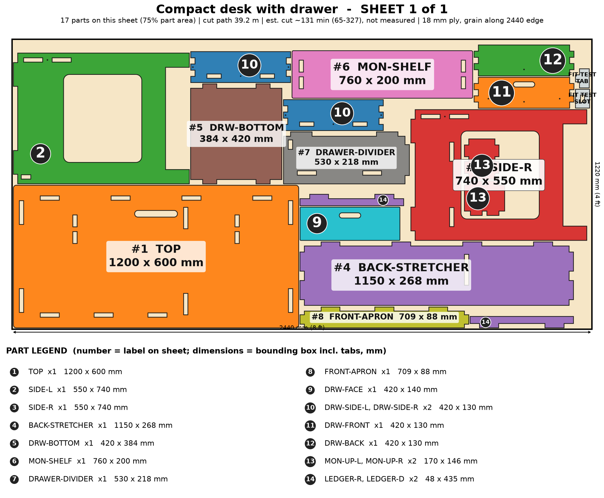

# Compact Desk with Drawer

A real desk cut to your room: panel legs with robot-vac clearance, a rear stretcher, hidden-joint drawer, monitor shelf and a cable slot.

> Planning numbers are ESTIMATES / ASSUMPTIONS. Machine times are estimates (sourced range, not measured; see ../CUT-SPEED-RESEARCH.md). Run the fit-test coupon (on sheet 1) before cutting a full sheet.

## Size
Overall 1200 W x 600 D x 740 H mm. 1 sheet(s) of 4x8 (1220 x 2440 mm) 18 mm ply, cut path 39.2 m.

## Parameters (edit `PARAMS` at the top of `model.py`)
| Parameter | Default | Sane limits |
|---|---|---|
| `width` | 1200.0 | 900-1600 mm (2nd divider/leg panel over 1400) |
| `depth` | 600.0 | 450-800 mm |
| `height` | 740.0 | 650-1050 mm |
| `thickness` | 18.0 | 17.5-19 mm |
| `clearance` | 0.1 | 0.0-0.2 mm |
| `plinth` | 100.0 | 90-150 mm |
| `drawer` | 1 | 0 or 1 |
| `drawer_w` | 420.0 | 300-520 mm |
| `drawer_len` | 420.0 | 300-480 mm (must fit the depth) |
| `monitor_shelf` | 1 | 0 or 1 |
| `cable_slot` | 1 | 0 or 1 |

Regenerate everything with `cd furniture-v2 && /workspace/venv-egg/bin/python run.py desk` (writes DXFs, sheet PNGs, assembly.png, parts.json, plan.json, checks.txt). The run also builds two stress variants of the parameters and checks them.

## Joinery
Through-tab joints, slot = tab + 0.1 mm each way; #8 screws with 3.0 mm pilots; Titebond III glue with the screws acting as clamps; 6 mm minimum spacing between nested parts.

Drawer, monitor shelf and cable slot are options. Raised on a plinth gap for robot vacuums. Nest uses small-part windows to stay on one sheet.

## Cut sheets
### Sheet 1  (`desk-nest-sheet1-1220x2440.dxf`, `sheet-1.png`)

Parts: TOP 1200x600, SIDE-L 550x740, SIDE-R 550x740, BACK-STRETCHER 1150x268, DRAWER-DIVIDER 530x218, FRONT-APRON 709x88, LEDGER-R 48x435, LEDGER-D 48x435, DRW-SIDE-L 420x130, DRW-SIDE-R 420x130, DRW-FRONT 420x130, DRW-BACK 420x130, DRW-BOTTOM 420x384, DRW-FACE 420x140, MON-SHELF 760x200, MON-UP-L 170x146, MON-UP-R 170x146

## Build stages (551 min total, estimate)
| # | Stage | min | What |
|---|---|---|---|
| 1 | Cut the sheets | 261 | Fit-test coupon first (slot = tab + 0.1 mm), then cut 1 sheet(s): 39 m of cut path. The 1200 x 600 TOP is the biggest part; keep it flat on the honeycomb and cut inside-out. |
| 2 | Remove char and sand | 70 | Brush char off every edge, 120 then 180 grit; round the desktop edge by hand (about 3 mm). Sand the side-panel windows. |
| 3 | Dry fit the frame | 20 | Stand SIDE-L and SIDE-R, slide the BACK-STRETCHER into both, add the DRAWER-DIVIDER and FRONT-APRON, then drop the TOP over all the tabs. Check the tab ends are flush with the desktop and the legs stand square. |
| 4 | Dry fit drawer | 20 | Assemble the drawer (finger corners, bottom with 4 tabs, face) and slide it on the two LEDGERs; it should run freely with 1.5 mm side play. Sand the finger pull slots. |
| 5 | Pre-finish | 50 | Oil or poly the desktop top, the drawer, and the inside faces now; mask the tabs and slots so the glue bonds. |
| 6 | Glue-up frame (Titebond III) | 35 | Glue the stretcher, apron, divider and ledgers into SIDE-L/R and the divider, then fit the TOP onto the tabs and clamp across the width. Wipe squeeze-out; 30 min clamp, 24 h before heavy use. |
| 7 | Screws as clamps | 25 | 10 #8 x 1-1/2 in and 2 #8 x 1-1/4 in screws (3.0 mm pilots pre-cut): through each side face into the back stretcher edge; the drawer corners, bottom and face as the nightstand drawer. |
| 8 | Monitor shelf and cable slot | 15 | Glue MON-UP-L/R into their top slots (they stand on the desktop and their tabs come through underneath), then the MON-SHELF onto their upper tabs. Edge-band or sand the cable slot. |
| 9 | Wall stabilizer / cleat (optional) | 15 | Screw a Z-bar half to the rear face of the BACK-STRETCHER and the other half into studs to stop the desk creeping or wobbling. It is a stabilizer, not a floating-desk mount. |
| 10 | Finish and pack | 40 | Last coat, 24 h cure, felt pads under the 4 feet, load-test 60 kg on the desktop centre, flat-pack with corner guards (parts up to 1.2 m). |

## Materials and hardware
Sheet: 18 mm (3/4 in) birch or Baltic-birch plywood, 4 x 8 ft x 1 (hardwood-ply top is a CNC upgrade)

| Item | Qty | Unit $ (est.) | Note |
|---|---|---|---|
| #8 x 1-1/2 in wood screws | 10 | 0.06 | from model |
| #8 x 1-1/4 in wood screws | 2 | 0.06 |  |
| Aluminum Z-bar pair (wall stabilizer) | 1 | 12.0 | optional |
| Felt/rubber foot pads | 4 | 0.4 |  |
| Cable grommet (optional) | 1 | 3.0 | 60 mm plastic |
| Wood plugs / filler | 1 | 2.0 |  |

Glue: Titebond III, about 5 oz. Finish: hardwax oil or water-based poly, 3 coats on the top (about $15).

## Profit estimate (ESTIMATES / ASSUMPTIONS)
All dollar figures are planning ESTIMATES / ASSUMPTIONS, not quotes, not guaranteed. Sheet prices: 4x8 ft 18 mm birch plywood $70-110, basic plywood $55-75 (assumption). Machine time uses a sourced RANGE for a 120 W diode on 18 mm ply (low 120 / typical 300 / high 600 mm/min effective, i.e. after multiple passes; see CUT-SPEED-RESEARCH.md); ACMER publishes no 18 mm ply feed rate, so none of it is measured on this machine. Machine wear/electricity $1.70 per machine-hour (assumption). Labor valued at $25/h for the "after labor" line only. Marketplace fees 10% (assumption, e.g. Etsy-style).

Price band source: SHORTLIST.md: custom target $250-$600 (estimate); small computer desks widely sold ~$100-$400 [third-party estimates]

| | Low | Mid | High |
|---|---|---|---|
| Price | $250 | $425 | $600 |
| COGS (sheets at mid + hardware + finish + packaging + machine wear) | $147 | $147 | $147 |
| Gross margin | $103 (41%) | $278 (66%) | $453 (76%) |
| Gross margin if you absorb shipping (est. $60) | $43 | $218 | $393 |
| Net after 10% fees and labor | $8 | $166 | $323 |

### Machine time and profit per machine hour (ESTIMATE, at the mid price; includes 15 min/sheet of load, focus and unload, rapid travel between 73 contours)
| Scenario | Effective rate | Machine hours per unit | COGS | Gross margin | Gross margin per machine hour | Net after fees+labor per machine hour |
|---|---|---|---|---|---|---|
| Diode, slow case | 120 mm/min (5 pass x 600 mm/min) | 5.8 | $152 | $273 | $47 | $27 |
| Diode, typical | 300 mm/min (4 pass x 1200 mm/min) | 2.5 | $147 | $278 | $109 | $65 |
| Diode, best case | 600 mm/min (2 pass x 1200 mm/min) | 1.4 | $145 | $280 | $200 | $120 |
| Commercial CO2 300-600 W (sourced) | 600 mm/min (1 pass x 600 mm/min) | 1.2 | $152 | $273 | $232 | $136 |
| What-if 10x faster than diode typical (assumption) | x10 on diode typical cut+travel | 0.3 | $145 | $280 | $904 | $541 |
| What-if 20x faster (assumption) | x20 on diode typical cut+travel | 0.2 | $144 | $281 | $1405 | $843 |

ESTIMATE: 2.5 h (low-speed case 5.8 h, best case 1.4 h) of machine time per unit for 39 m of cut path in 1 sheet(s) on a 120 W diode, 18 mm plywood. Machine time, not material, is still the limit on profit per hour, but a single test cut on scrap will replace this range with a real number.

ASSUMPTION. Sourced case: 300-600 W CO2 flatbed, single pass at ~600 mm/min (vendor 480-720), 60 m/min rapids, 5 min/sheet, $8/h operating cost. What-if cases: a machine 10x / 20x faster than the diode mid cut+travel time (not sourced for 18 mm ply).

Sources and method: ../CUT-SPEED-RESEARCH.md.

## Safety
- Rated target 60 kg distributed on the desktop - UNVERIFIED; sag-test a 1200 mm top with 20 kg at the centre.
- Top is held only by through-tabs and glue: let the glue cure 24 h before loading.
- Stand-height (1000 mm) builds are less stable: fit the wall stabilizer and widen the stance (depth >= 650).
- Not a children's product.

## Unverified / caveats
- Desktop deflection with 18 mm ply over 1200 mm not tested; rear stretcher and divider are the only stiffeners.
- Machine time is an estimate (120 W diode on 18 mm ply, sourced range, not measured on this machine); cut time and profit/hour depend on it.
- Visible tab ends on the desktop surface (sand flush / cover with a desk mat or veneer).
- Drawer slides on plywood ledgers (no hardware slides).
- Price band is an estimate from SHORTLIST.md.

## Verification
See `checks.txt` (assembled-model overlap/containment, nest overlap, DXF read-back).
