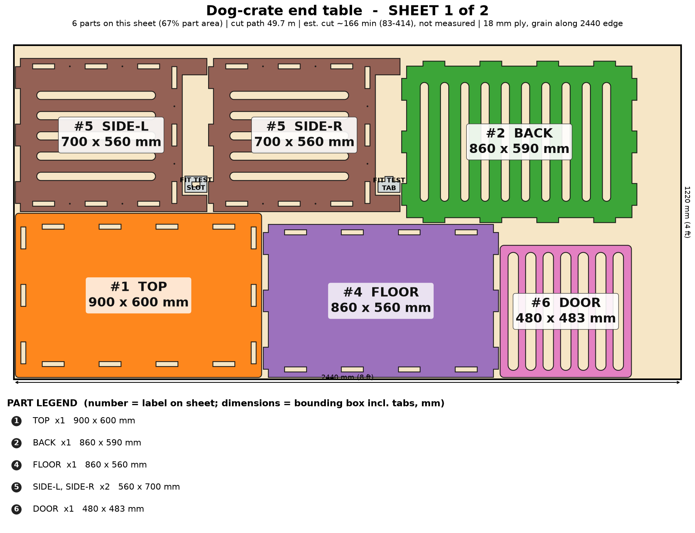
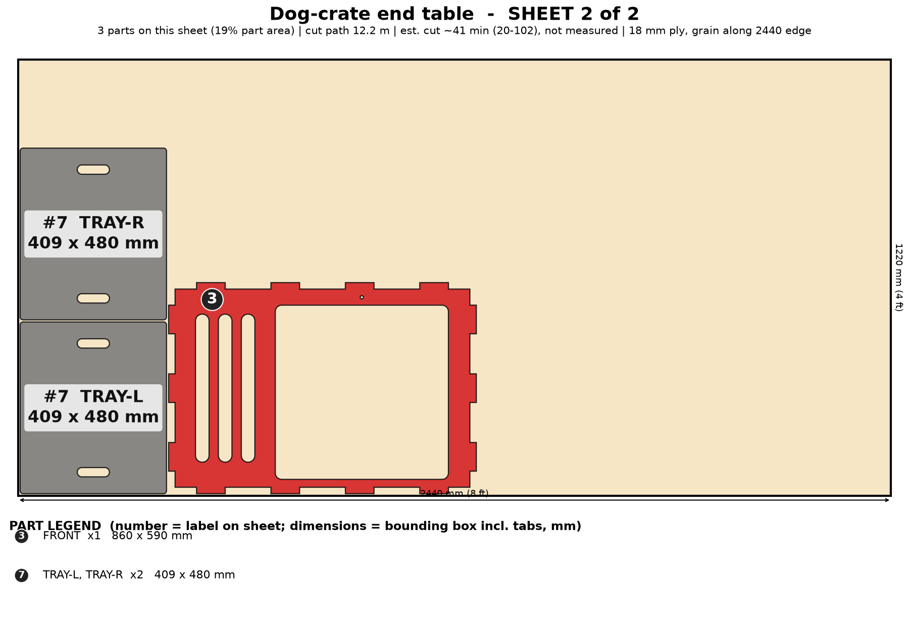

# Dog-Crate End Table

A dog crate that looks like furniture: tabletop, slatted door, ventilated sides, lift-out washable trays, sized to your dog.

> Planning numbers are ESTIMATES / ASSUMPTIONS. Machine times are estimates (sourced range, not measured; see ../CUT-SPEED-RESEARCH.md). Run the fit-test coupon (on sheet 1) before cutting a full sheet.

## Size
Overall 900 W x 600 D x 700 H mm. 2 sheet(s) of 4x8 (1220 x 2440 mm) 18 mm ply, cut path 61.9 m.

## Parameters (edit `PARAMS` at the top of `model.py`)
| Parameter | Default | Sane limits |
|---|---|---|
| `width` | 900.0 | 700-1300 mm |
| `depth` | 600.0 | 480-800 mm |
| `height` | 700.0 | 600-900 mm (interior = height - plinth - 20 - 4T) |
| `thickness` | 18.0 | 17.5-19 mm |
| `clearance` | 0.1 | 0.0-0.2 mm |
| `plinth` | 90.0 | 60-150 mm |
| `door_w` | 480.0 | 300-560 mm |
| `slat_gap` | 38.0 | 25-45 mm (small dog 25-30, medium 38, large 45) |
| `slat_bar` | 26.0 | 20-40 mm |

Regenerate everything with `cd furniture-v2 && /workspace/venv-egg/bin/python run.py dog-crate` (writes DXFs, sheet PNGs, assembly.png, parts.json, plan.json, checks.txt). The run also builds two stress variants of the parameters and checks them.

## Joinery
Through-tab joints, slot = tab + 0.1 mm each way; #8 screws with 3.0 mm pilots; Titebond III glue with the screws acting as clamps; 6 mm minimum spacing between nested parts.

Door hinges on the right with surface-mount hinges and a barrel bolt into a 9 mm header hole. Two floor-tray halves lift out through the door. All screws are on outside faces. Intended for dogs up to about 18 kg (UNVERIFIED).

## Cut sheets
### Sheet 1  (`dog-crate-nest-sheet1-1220x2440.dxf`, `sheet-1.png`)

Parts: TOP 900x600, SIDE-L 560x700, SIDE-R 560x700, FLOOR 860x560, BACK 860x590, DOOR 480x483

### Sheet 2  (`dog-crate-nest-sheet2-1220x2440.dxf`, `sheet-2.png`)

Parts: FRONT 860x590, TRAY-L 409x480, TRAY-R 409x480

## Build stages (782 min total, estimate)
| # | Stage | min | What |
|---|---|---|---|
| 1 | Cut the sheets | 412 | Fit-test coupon first (slot = tab + 0.1 mm); cut 2 sheet(s): 62 m of path with 30 rounded vent/slat openings. Use cabinet-grade ply with NAUF/CARB2 glue (no MDF - dogs chew it and moisture swells it). Inside-out order, air assist on. |
| 2 | Remove char, sand, round every edge | 120 | Brush the char off, 120 then 180 then 220 grit. Hand-round ALL edges, slot ends and the inside of the door opening (about 3 mm) - no splinters or sharp arrises where a dog can rub. Sand the tab ends flush later. |
| 3 | Dry fit | 20 | Stand SIDE-L/R, slide in FLOOR, FRONT and BACK, then drop TOP over every tab. Check the DOOR sits in its opening with about 2 mm all round and the trays drop in. |
| 4 | Pre-finish (pet-safe) | 75 | Finish every part before glue-up with a cured pet-safe finish (water-based poly or food-safe hardwax oil, 2-3 coats); let it cure fully (3-7 days is best) before a dog goes in. Mask tabs and slots. |
| 5 | Glue-up (Titebond III) | 35 | Glue FLOOR, FRONT and BACK into SIDE-L, add SIDE-R, then seat TOP on all tabs. Clamp across the width and check it is square. Wipe squeeze-out; no glue on the door or trays. |
| 6 | Screws from the outside only | 20 | 12 #8 x 1-1/2 in screws (3.0 mm pilots pre-cut) through the side faces into the floor, front and back edges. Nothing protrudes inside the crate. Countersink and plug. |
| 7 | Hang the door | 30 | Two 3 in surface-mount flush hinges on the right: pre-drill 2.5 mm for the hinge screws, set the door with 2 mm gaps (never wider than 4 mm - paw safety). Fit a dog-proof barrel bolt on the door and drop its pin through the 9 mm hole in the header. |
| 8 | Sand tab ends and final finish | 40 | Sand the tab ends on the tabletop flush, final coat on the top (wipe-clean, heat/water resistant poly), edge-seal the cut ends. |
| 9 | Pad, test, pack | 30 | Lay a washable pad on the trays. Shake test, then flat-pack: parts up to 900 x 600 mm in one box with corner guards; include hinge and bolt hardware and the care and safety sheet. |

## Materials and hardware
Sheet: 18 mm (3/4 in) birch cabinet plywood (NAUF/CARB2 glue), 4 x 8 ft x 2 - no MDF

| Item | Qty | Unit $ (est.) | Note |
|---|---|---|---|
| #8 x 1-1/2 in wood screws | 12 | 0.06 | from model |
| 3 in surface-mount flush hinges (pair) | 1 | 7.0 | door |
| Dog-proof barrel bolt / slide latch | 1 | 6.0 | pin goes in the 9 mm header hole |
| Wood plugs / filler | 1 | 2.0 |  |
| Felt/rubber foot pads | 4 | 0.4 |  |
| Washable crate pad (optional add-on) | 0 | 0.0 | sold separately |

Glue: Titebond III, about 5 oz. Finish: pet-safe water-based poly or food-safe hardwax oil, 3 coats (about $18).

## Profit estimate (ESTIMATES / ASSUMPTIONS)
All dollar figures are planning ESTIMATES / ASSUMPTIONS, not quotes, not guaranteed. Sheet prices: 4x8 ft 18 mm birch plywood $70-110, basic plywood $55-75 (assumption). Machine time uses a sourced RANGE for a 120 W diode on 18 mm ply (low 120 / typical 300 / high 600 mm/min effective, i.e. after multiple passes; see CUT-SPEED-RESEARCH.md); ACMER publishes no 18 mm ply feed rate, so none of it is measured on this machine. Machine wear/electricity $1.70 per machine-hour (assumption). Labor valued at $25/h for the "after labor" line only. Marketplace fees 10% (assumption, e.g. Etsy-style).

Price band source: SHORTLIST.md: Etsy median $395; custom target $350-$700 (estimate)

| | Low | Mid | High |
|---|---|---|---|
| Price | $350 | $525 | $700 |
| COGS (sheets at mid + hardware + finish + packaging + machine wear) | $242 | $242 | $242 |
| Gross margin | $108 (31%) | $283 (54%) | $458 (65%) |
| Gross margin if you absorb shipping (est. $74) | $34 | $209 | $384 |
| Net after 10% fees and labor | $-15 | $143 | $300 |

### Machine time and profit per machine hour (ESTIMATE, at the mid price; includes 15 min/sheet of load, focus and unload, rapid travel between 100 contours)
| Scenario | Effective rate | Machine hours per unit | COGS | Gross margin | Gross margin per machine hour | Net after fees+labor per machine hour |
|---|---|---|---|---|---|---|
| Diode, slow case | 120 mm/min (5 pass x 600 mm/min) | 9.3 | $251 | $274 | $30 | $14 |
| Diode, typical | 300 mm/min (4 pass x 1200 mm/min) | 4.1 | $242 | $283 | $69 | $35 |
| Diode, best case | 600 mm/min (2 pass x 1200 mm/min) | 2.3 | $239 | $286 | $125 | $64 |
| Commercial CO2 300-600 W (sourced) | 600 mm/min (1 pass x 600 mm/min) | 1.9 | $250 | $275 | $145 | $71 |
| What-if 10x faster than diode typical (assumption) | x10 on diode typical cut+travel | 0.5 | $240 | $285 | $539 | $274 |
| What-if 20x faster (assumption) | x20 on diode typical cut+travel | 0.3 | $238 | $287 | $820 | $420 |

ESTIMATE: 4.1 h (low-speed case 9.3 h, best case 2.3 h) of machine time per unit for 62 m of cut path in 2 sheet(s) on a 120 W diode, 18 mm plywood. Machine time, not material, is still the limit on profit per hour, but a single test cut on scrap will replace this range with a real number.

ASSUMPTION. Sourced case: 300-600 W CO2 flatbed, single pass at ~600 mm/min (vendor 480-720), 60 m/min rapids, 5 min/sheet, $8/h operating cost. What-if cases: a machine 10x / 20x faster than the diode mid cut+travel time (not sourced for 18 mm ply).

Sources and method: ../CUT-SPEED-RESEARCH.md.

## Safety
- Animal safety (design intent, NOT certified): all openings <= 38 mm, every slot end rounded, door gap about 2 mm, no screws or hinge hardware inside, tabs flush.
- Use a dog-proof latch and test with the dog supervised; this is a rest crate, not a restraint or vehicle crate.
- Pet-safe cured finish only; no MDF, no chemical stains inside; ventilation about 30 slotted openings.
- Interior 824 x 484 x 536 mm: check the dog's shoulder height + 50 mm, nose-to-tail length + 80 mm before ordering; the default suits a dog up to about 18 kg.
- Tabletop rating target 25 kg of objects (UNVERIFIED); the crate floor target 40 kg dog (UNVERIFIED).

## Unverified / caveats
- Not tested with an animal; rating and chew resistance unknown.
- Hinge and bolt positions are guidance; screw holes for hinges are drilled by hand.
- Machine time is an estimate (120 W diode on 18 mm ply, sourced range, not measured on this machine); cut time and profit/hour depend on it.
- Height default is 700 mm (spec said ~650): the extra 50 mm keeps a 90 mm robot-vac plinth and a 536 mm interior.
- Visible tab ends on the tabletop (sand flush or cover).
- Price band is an estimate from SHORTLIST.md.

## Verification
See `checks.txt` (assembled-model overlap/containment, nest overlap, DXF read-back).
