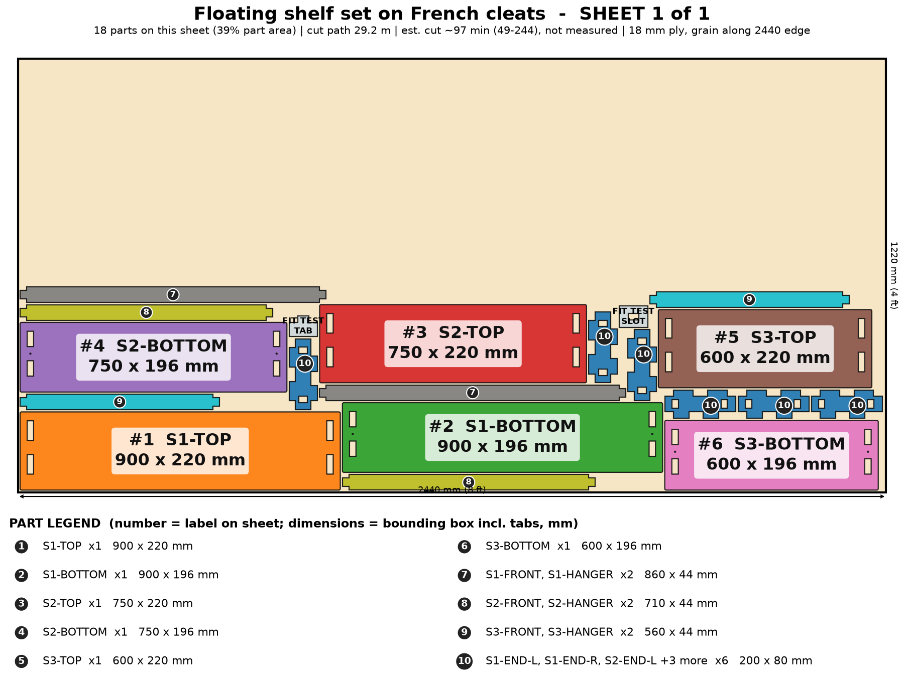

# Floating Shelf Set on French Cleats

A set of hollow floating shelves, each hung on a concealed aluminum Z-bar French cleat, stepped in length. Off the floor entirely, so the robot vacuum is unaffected.

> Planning numbers are ESTIMATES / ASSUMPTIONS. Machine times are estimates (sourced range, not measured; see ../CUT-SPEED-RESEARCH.md). Run the fit-test coupon (on sheet 1) before cutting a full sheet.

## Size
Overall 900 W x 220 D x 680 H mm. 1 sheet(s) of 4x8 (1220 x 2440 mm) 18 mm ply, cut path 29.2 m.

## Parameters (edit `PARAMS` at the top of `model.py`)
| Parameter | Default | Sane limits |
|---|---|---|
| `width` | 900.0 | 400-1200 mm |
| `shelves` | 3 | 1-5 |
| `depth` | 220.0 | 190-300 mm |
| `shelf_height` | 80.0 | 76-110 mm |
| `pitch` | 300.0 | 200-500 mm (>= height + 120) |
| `step` | 150.0 | 0-300 mm (shortest >= 300) |
| `thickness` | 18.0 | 17.5-19 mm |
| `clearance` | 0.1 | 0.0-0.2 mm |

Regenerate everything with `cd furniture-v2 && /workspace/venv-egg/bin/python run.py floating-shelves` (writes DXFs, sheet PNGs, assembly.png, parts.json, plan.json, checks.txt). The run also builds two stress variants of the parameters and checks them.

## Joinery
Through-tab joints, slot = tab + 0.1 mm each way; #8 screws with 3.0 mm pilots; Titebond III glue with the screws acting as clamps; 6 mm minimum spacing between nested parts.

Each shelf is a hollow box (TOP, BOTTOM, 2 ENDS, FRONT, HANGER). The HANGER plate takes the shelf half of an aluminum Z-bar French cleat; the BOTTOM stops 24 mm short of the wall so the shelf drops over the wall half. TOP and BOTTOM overhang the recessed box by 20 mm (shadow line). Joinery simplified: ply-only cleats were dropped because the laser cannot cut a 45 degree bevel.

## Cut sheets
### Sheet 1  (`floating-shelves-nest-sheet1-1220x2440.dxf`, `sheet-1.png`)

Parts: S1-TOP 900x220, S1-BOTTOM 900x196, S1-END-L 200x80, S1-END-R 200x80, S1-FRONT 860x44, S1-HANGER 860x44, S2-TOP 750x220, S2-BOTTOM 750x196, S2-END-L 200x80, S2-END-R 200x80, S2-FRONT 710x44, S2-HANGER 710x44, S3-TOP 600x220, S3-BOTTOM 600x196, S3-END-L 200x80, S3-END-R 200x80, S3-FRONT 560x44, S3-HANGER 560x44

## Build stages (516 min total, estimate)
| # | Stage | min | What |
|---|---|---|---|
| 1 | Cut the sheet(s) | 195 | Run the fit-test coupon first (slot = tab + 0.1 mm), then cut 1 sheet(s) from the DXFs (CUT layer): 29 m of path, 18 parts. Inside-out order, air assist on. |
| 2 | Remove char and sand | 72 | Brush the char off every edge, 120 then 180 grit. Ease the TOP front and side edges (the visible top slab); sand the slot ends flush later, after glue. |
| 3 | Dry fit one shelf | 30 | For each shelf: stand the two END plates, drop the FRONT and HANGER between them, then fit BOTTOM underneath and TOP on top of all the tabs. Check the box is square and the cavity is clear for the Z-bar. |
| 4 | Pre-finish | 65 | Stain or seal the inside of the box and the HANGER rear face lightly, then finish TOP/BOTTOM faces. Mask the tabs and slots so the glue still bonds. |
| 5 | Glue-up (Titebond III) | 60 | Per shelf: glue the ENDs into BOTTOM, add FRONT and HANGER, then seat TOP over every tab. Clamp with cauls across the width. Wipe squeeze-out. |
| 6 | Screws as clamps | 24 | 6 #8 x 1-1/2 in screws (3.0 mm pilots cut in the BOTTOM): from the underside up into the END plates, between the tabs. The TOP is glue and tab only, so the top face stays clean; clamp it with cauls while it dries. |
| 7 | Fit the Z-bar cleats | 45 | Screw the shelf half of each aluminum Z-bar (lengths 24/24/18 in) to the rear face of the HANGER with #8 x 5/8 in screws (shorter than the 18 mm plate, so they cannot show). Mount the wall half level into studs (2 screws per stud, 16 in centers), then hang the shelf from above. |
| 8 | Hang, test, pack | 25 | Hang, then load-test each shelf with 10 kg at the front edge. Flat-pack in one 1.0 x 0.3 x 0.1 m box. |

## Materials and hardware
Sheet: 18 mm (3/4 in) birch or Baltic-birch plywood, 4 x 8 ft (1220 x 2440 mm) x 1

| Item | Qty | Unit $ (est.) | Note |
|---|---|---|---|
| #8 x 1-1/2 in wood screws | 6 | 0.06 | from model |
| Aluminum Z-bar French cleat pair (wall half + shelf half), lengths 24/24/18 in | 1 | 36.3 | about $0.55 per inch per pair (assumption); laser cannot cut the 45 deg bevel |
| #8 x 5/8 in screws for the shelf-half bars | 18 | 0.04 |  |
| Wall screws / stud screws for the wall-half bars | 12 | 0.15 | #10 x 2-1/2 in; into studs |
| Wood plugs / filler | 1 | 2.0 |  |

Glue: Titebond III, about 3 oz. Finish: stain or water-based poly, 2 coats (about $10).

## Profit estimate (ESTIMATES / ASSUMPTIONS)
All dollar figures are planning ESTIMATES / ASSUMPTIONS, not quotes, not guaranteed. Sheet prices: 4x8 ft 18 mm birch plywood $70-110, basic plywood $55-75 (assumption). Machine time uses a sourced RANGE for a 120 W diode on 18 mm ply (low 120 / typical 300 / high 600 mm/min effective, i.e. after multiple passes; see CUT-SPEED-RESEARCH.md); ACMER publishes no 18 mm ply feed rate, so none of it is measured on this machine. Machine wear/electricity $1.70 per machine-hour (assumption). Labor valued at $25/h for the "after labor" line only. Marketplace fees 10% (assumption, e.g. Etsy-style).

Price band source: My estimate: single floating shelves sell for about $25-$60 at commodity level and $60-$120 handmade (Etsy; SHORTLIST.md "considered and not picked" because commodity pricing is low). A 3-shelf stepped set, finished, with the cleat hardware included, is priced as a set. Low = 2 short unfinished shelves, high = 5 long finished.

| | Low | Mid | High |
|---|---|---|---|
| Price | $130 | $210 | $320 |
| COGS (sheets at mid + hardware + finish + packaging + machine wear) | $154 | $154 | $154 |
| Gross margin | $-24 (-19%) | $56 (26%) | $166 (52%) |
| Gross margin if you absorb shipping (est. $38) | $-62 | $18 | $128 |
| Net after 10% fees and labor | $-92 | $-20 | $78 |

### Machine time and profit per machine hour (ESTIMATE, at the mid price; includes 15 min/sheet of load, focus and unload, rapid travel between 63 contours)
| Scenario | Effective rate | Machine hours per unit | COGS | Gross margin | Gross margin per machine hour | Net after fees+labor per machine hour |
|---|---|---|---|---|---|---|
| Diode, slow case | 120 mm/min (5 pass x 600 mm/min) | 4.4 | $159 | $51 | $12 | $-6 |
| Diode, typical | 300 mm/min (4 pass x 1200 mm/min) | 1.9 | $154 | $56 | $28 | $-11 |
| Diode, best case | 600 mm/min (2 pass x 1200 mm/min) | 1.1 | $153 | $57 | $52 | $-17 |
| Commercial CO2 300-600 W (sourced) | 600 mm/min (1 pass x 600 mm/min) | 0.9 | $158 | $52 | $57 | $-27 |
| What-if 10x faster than diode typical (assumption) | x10 on diode typical cut+travel | 0.2 | $153 | $57 | $227 | $-77 |
| What-if 20x faster (assumption) | x20 on diode typical cut+travel | 0.2 | $153 | $57 | $338 | $-109 |

ESTIMATE: 1.9 h (low-speed case 4.4 h, best case 1.1 h) of machine time per unit for 29 m of cut path in 1 sheet(s) on a 120 W diode, 18 mm plywood. Machine time, not material, is still the limit on profit per hour, but a single test cut on scrap will replace this range with a real number.

ASSUMPTION. Sourced case: 300-600 W CO2 flatbed, single pass at ~600 mm/min (vendor 480-720), 60 m/min rapids, 5 min/sheet, $8/h operating cost. What-if cases: a machine 10x / 20x faster than the diode mid cut+travel time (not sourced for 18 mm ply).

Sources and method: ../CUT-SPEED-RESEARCH.md.

## Safety
- Mount the wall half of each cleat into studs only (not drywall anchors alone); level it before hanging.
- Rated target 10 kg per shelf at a 220 mm depth, UNVERIFIED - load test each shelf at 15 kg before selling; the rating falls as depth grows.
- Keep heavy items (books, appliances) on a conventional bookcase, not on a floating shelf.
- Not a children's product (no CPSIA testing); do not use as a climbing aid.

## Unverified / caveats
- Machine time is an estimate (120 W diode on 18 mm ply, sourced range, not measured on this machine); cut time and profit/hour depend on it.
- Z-bar cleat load rating and the pull-out strength of the shelf-half screws in an 18 mm HANGER face are not tested; the checks.txt load-path line is a rough hand estimate.
- Z-bar profile dimensions differ by supplier (the 24 mm recess and 44 mm cavity are sized for a typical 1 in bar and must be confirmed with the bar you buy).
- The wall bar is aluminum from a hardware store: the laser cannot cut a true 45 deg bevel in ply, so ply-only cleats are not offered.
- The cost model charges one whole 4x8 sheet but this set fills only 39% of it (offcut not credited). Nesting 2 sets per sheet (area allows it; not nested here) would cut mid cost to about $110 and lift mid gross margin from 26% to about 48%. The Z-bar hardware (about $36) is a large share of cost. As modeled, the low price band is below cost.
- Price band is my estimate, not a market quote.

## Verification
See `checks.txt` (assembled-model overlap/containment, nest overlap, DXF read-back).
