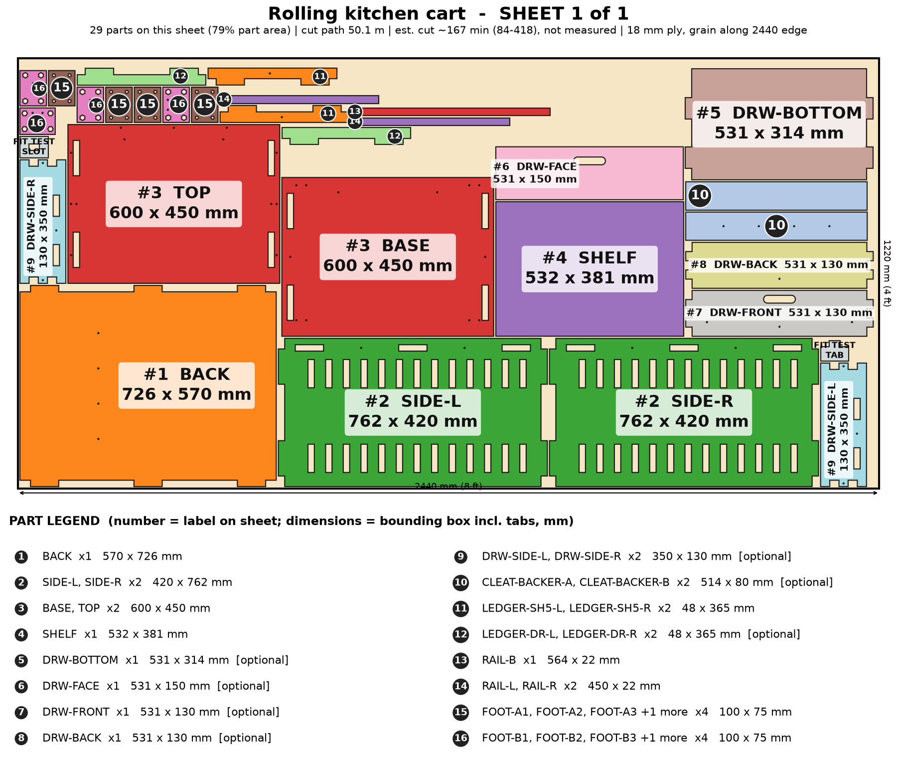

# Rolling Kitchen Cart

A rolling cart for toasters and panini presses: 13 slot rows for shelves on a 50 mm pitch, an optional drawer, locking casters, and one dense 4x8 sheet.

> Planning numbers are ESTIMATES / ASSUMPTIONS. Machine times are estimates (sourced range, not measured; see ../CUT-SPEED-RESEARCH.md). Run the fit-test coupon (on sheet 1) before cutting a full sheet.

## Size
Overall 600 W x 450 D x 900 H mm. 1 sheet(s) of 4x8 (1220 x 2440 mm) 18 mm ply, cut path 50.1 m.

## Parameters (edit `PARAMS` at the top of `model.py`)
| Parameter | Default | Sane limits |
|---|---|---|
| `width` | 600.0 | 450-750 mm (over 750 would need a centre post; not modeled) |
| `depth` | 450.0 | 380-560 mm |
| `height` | 900.0 | 760-1000 mm |
| `thickness` | 18.0 | 17.5-19 mm |
| `clearance` | 0.1 | 0.0-0.2 mm |

Regenerate everything with `cd furniture-v2 && /workspace/venv-egg/bin/python run.py kitchen-cart` (writes DXFs, sheet PNGs, assembly.png, parts.json, plan.json, checks.txt). The run also builds two stress variants of the parameters and checks them.

## Joinery
Through-tab joints, slot = tab + 0.1 mm each way; #8 screws with 3.0 mm pilots; Titebond III glue with the screws acting as clamps; 6 mm minimum spacing between nested parts.

Rebuilt from the first-round cart and now parametric (width, depth, height). Shelf slot rows follow the height on a 50 mm pitch. Casters and Z-bar are purchased parts. Over 750 mm wide would need a centre post (not modeled).

## Cut sheets
### Sheet 1  (`kitchen-cart-nest-sheet1-1220x2440.dxf`, `sheet-1.png`)

Parts: BASE 600x450, TOP 600x450, SIDE-L 420x762, SIDE-R 420x762, BACK 570x726, RAIL-L 450x22, RAIL-R 450x22, RAIL-B 564x22, LEDGER-SH5-L 48x365, LEDGER-SH5-R 48x365, LEDGER-DR-L 48x365 (opt), LEDGER-DR-R 48x365 (opt), SHELF 532x381, FOOT-A1 100x75, FOOT-B1 100x75, FOOT-A2 100x75, FOOT-B2 100x75, FOOT-A3 100x75, FOOT-B3 100x75, FOOT-A4 100x75, FOOT-B4 100x75, DRW-SIDE-L 350x130 (opt), DRW-SIDE-R 350x130 (opt), DRW-FRONT 531x130 (opt), DRW-BACK 531x130 (opt), DRW-BOTTOM 531x314 (opt), DRW-FACE 531x150 (opt), CLEAT-BACKER-A 514x80 (opt), CLEAT-BACKER-B 514x80 (opt)

## Build stages (674 min total, estimate)
| # | Stage | min | What |
|---|---|---|---|
| 1 | Cut the sheet | 334 | Cut the fit-test coupon first (slot = tab + 0.1 mm), then the 29-part sheet from the DXF (CUT layer): 50 m of path. The cart is the densest nest: expect a long run, so check the sheet is flat and weighted before starting. |
| 2 | Remove char and sand | 60 | Brush the char off every edge, sand 120 then 180 grit, ease the worktop edge and the shelf fronts by hand. |
| 3 | Dry fit | 20 | Stand SIDE-L and SIDE-R on BASE, add BACK, RAILs, the worktop, and slide in a SHELF on its LEDGERs. Check the shelf-slot pitch (50 mm) and that the tabs end flush. |
| 4 | Pre-finish | 60 | Seal every face now, the worktop most of all (kitchen use: water-based poly, 3 coats on top). Mask the tabs and slots so the glue bonds to bare wood. |
| 5 | Feet and casters | 30 | Glue and screw the FOOT-A and FOOT-B pairs under the base (8 x #8 x 1-3/4 in), then bolt the 4 casters on the 73.2 x 44.5 mm pattern with M8 bolts and nuts. Fit at least 2 locking casters. |
| 6 | Glue-up (Titebond III) | 35 | Glue SIDE-L and SIDE-R onto BASE, the BACK, then the three RAILs, then set the worktop over the side tabs. Clamp across the width and check diagonals. |
| 7 | Screws as clamps | 30 | 45 #8 screws in all: #8 x 1-1/2 in through the side faces and top; #8 x 1-1/4 in for rails and shelf locks. Pilots are laser-cut at 3.0 mm. |
| 8 | Shelves and ledgers | 20 | Screw a LEDGER pair into the slot row you choose, then drop in the SHELF and lock it with the 2 SHELF-LOCK screws. Move rows in 50 mm steps for tall appliances. |
| 9 | Optional drawer and cleat | 45 | Drawer: glue the finger-jointed box, drop in the bottom, screw DRW-FACE, set on its DRAW ledgers. Cleat: glue the two CLEAT-BACKER layers to the back and fit the Z-bar. A loaded cart is not wall-hung: use the cleat for an empty/tidy-storage version only. |
| 10 | Finish, load test, pack | 40 | Final coat, 24 h cure, a 40 kg load test rolled across a doorstep, lock check on a slope, then flat-pack. |

## Materials and hardware
Sheet: 18 mm (3/4 in) sanded plywood (basic birch-faced or cabinet ply), 4 x 8 ft x 1

| Item | Qty | Unit $ (est.) | Note |
|---|---|---|---|
| #8 x 1-1/2 in wood screws | 20 | 0.06 | from model |
| #8 x 1-1/4 in wood screws | 13 | 0.06 | rails, shelf locks, drawer face |
| #8 x 1-3/4 in wood screws | 12 | 0.08 | feet, cleat backer |
| 3 in locking swivel casters (73.2 x 44.5 mm plate, M8) | 4 | 7.0 | ASSUMPTION: about $7 each, 2 locking minimum |
| M8 bolt + nyloc nut sets | 16 | 0.35 | caster mount |
| Aluminum Z-bar French cleat pair | 1 | 8.0 | optional, empty / light-duty wall version |
| Felt/rubber stops | 2 | 0.5 | drawer |

Glue: Titebond III, about 4 oz. Finish: water-based poly, 3 coats on the worktop (about $14).

## Profit estimate (ESTIMATES / ASSUMPTIONS)
All dollar figures are planning ESTIMATES / ASSUMPTIONS, not quotes, not guaranteed. Sheet prices: 4x8 ft 18 mm birch plywood $70-110, basic plywood $55-75 (assumption). Machine time uses a sourced RANGE for a 120 W diode on 18 mm ply (low 120 / typical 300 / high 600 mm/min effective, i.e. after multiple passes; see CUT-SPEED-RESEARCH.md); ACMER publishes no 18 mm ply feed rate, so none of it is measured on this machine. Machine wear/electricity $1.70 per machine-hour (assumption). Labor valued at $25/h for the "after labor" line only. Marketplace fees 10% (assumption, e.g. Etsy-style).

Price band source: ASSUMPTION (not in SHORTLIST.md): $180-$420 band, set against 2-shelf rolling kitchen carts at roughly $70-$250 retail [third-party estimate]

| | Low | Mid | High |
|---|---|---|---|
| Price | $180 | $280 | $420 |
| COGS (sheets at mid + hardware + finish + packaging + machine wear) | $142 | $142 | $142 |
| Gross margin | $38 (21%) | $138 (49%) | $278 (66%) |
| Gross margin if you absorb shipping (est. $54) | $-16 | $84 | $224 |
| Net after 10% fees and labor | $-55 | $35 | $161 |

### Machine time and profit per machine hour (ESTIMATE, at the mid price; includes 15 min/sheet of load, focus and unload, rapid travel between 193 contours)
| Scenario | Effective rate | Machine hours per unit | COGS | Gross margin | Gross margin per machine hour | Net after fees+labor per machine hour |
|---|---|---|---|---|---|---|
| Diode, slow case | 120 mm/min (5 pass x 600 mm/min) | 7.5 | $149 | $131 | $18 | $4 |
| Diode, typical | 300 mm/min (4 pass x 1200 mm/min) | 3.2 | $142 | $138 | $43 | $11 |
| Diode, best case | 600 mm/min (2 pass x 1200 mm/min) | 1.7 | $140 | $140 | $81 | $22 |
| Commercial CO2 300-600 W (sourced) | 600 mm/min (1 pass x 600 mm/min) | 1.5 | $148 | $132 | $88 | $19 |
| What-if 10x faster than diode typical (assumption) | x10 on diode typical cut+travel | 0.4 | $140 | $140 | $370 | $98 |
| What-if 20x faster (assumption) | x20 on diode typical cut+travel | 0.2 | $138 | $142 | $616 | $168 |

ESTIMATE: 3.2 h (low-speed case 7.5 h, best case 1.7 h) of machine time per unit for 50 m of cut path in 1 sheet(s) on a 120 W diode, 18 mm plywood. Machine time, not material, is still the limit on profit per hour, but a single test cut on scrap will replace this range with a real number.

ASSUMPTION. Sourced case: 300-600 W CO2 flatbed, single pass at ~600 mm/min (vendor 480-720), 60 m/min rapids, 5 min/sheet, $8/h operating cost. What-if cases: a machine 10x / 20x faster than the diode mid cut+travel time (not sourced for 18 mm ply).

Sources and method: ../CUT-SPEED-RESEARCH.md.

## Safety
- Locking casters: lock at least two on any loaded or worktop use.
- Cart load rating is untested: target 40 kg shelves + 20 kg worktop, UNVERIFIED. Load test every design change.
- Tip: the cart is 900 mm tall and narrow; keep heavy appliances on the lowest shelves and do not roll over thresholds loaded.
- Do not run heat-producing appliances on the ply unprotected: use a trivet.
- Not a children's product (no CPSIA testing).

## Unverified / caveats
- Machine time is an estimate (120 W diode on 18 mm ply, sourced range, not measured on this machine); cut time and profit/hour depend on it.
- Load and tip behaviour untested.
- Price band is my assumption (cart is not in SHORTLIST.md).
- Caster price and fit are from the original design; the hole pattern is assumed for common 3 in plate casters.
- Depth and width ranges were build-checked only at the stress variants (400-520 mm deep, 480-800 mm wide).

## Verification
See `checks.txt` (assembled-model overlap/containment, nest overlap, DXF read-back).
