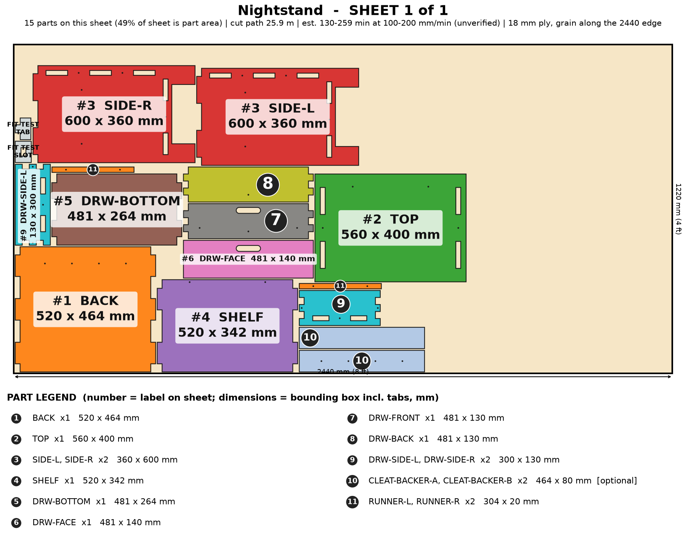

# Nightstand

A drawer-and-shelf nightstand that fits on a single 4x8 sheet, stands on its own feet so the robot vacuum goes underneath, and converts to a wall-hung French-cleat piece.

> Planning numbers are ESTIMATES / ASSUMPTIONS. Machine feed 100-200 mm/min is unverified. Run the fit-test coupon (on sheet 1) before cutting a full sheet.

## Size
Overall 560 W x 400 D x 600 H mm. 1 sheet(s) of 4x8 (1220 x 2440 mm) 18 mm ply, cut path 25.9 m.

## Parameters (edit `PARAMS` at the top of `model.py`)
| Parameter | Default | Sane limits |
|---|---|---|
| `width` | 560.0 | 400-800 mm |
| `depth` | 400.0 | 340-480 mm |
| `height` | 600.0 | 450-686 mm |
| `thickness` | 18.0 | 17.5-19 mm |
| `clearance` | 0.1 | 0.0-0.2 mm |
| `shelf_z` | 100.0 | 90-150 mm (robot-vacuum clearance under the shelf) |

Regenerate everything with `cd furniture-v2 && /workspace/venv-egg/bin/python run.py nightstand` (writes DXFs, sheet PNGs, assembly.png, parts.json, plan.json, checks.txt). The run also builds two stress variants of the parameters and checks them.

## Joinery
Through-tab joints, slot = tab + 0.1 mm each way; #8 screws with 3.0 mm pilots; Titebond III glue with the screws acting as clamps; 6 mm minimum spacing between nested parts.

Rebuilt from the first-round nightstand and now parametric (width, depth, height, shelf height). Includes the optional cleat backer layers.

## Cut sheets
### Sheet 1  (`nightstand-nest-sheet1-1220x2440.dxf`, `sheet-1.png`)

Parts: TOP 560x400, SIDE-L 360x600, SIDE-R 360x600, SHELF 520x342, BACK 520x464, RUNNER-L 304x20, RUNNER-R 304x20, DRW-SIDE-L 300x130, DRW-SIDE-R 300x130, DRW-FRONT 481x130, DRW-BACK 481x130, DRW-BOTTOM 481x264, DRW-FACE 481x140, CLEAT-BACKER-A 464x80 (opt), CLEAT-BACKER-B 464x80 (opt)

## Build stages (418 min total, estimate)
| # | Stage | min | What |
|---|---|---|---|
| 1 | Cut the sheet | 173 | Cut the fit-test coupon first (slot = tab + 0.1 mm), then the sheet from the DXF (CUT layer): 26 m of path. Cut small holes and slots first, outlines last; air assist on. |
| 2 | Remove char and sand | 45 | Brush the char off every cut edge, then 120 and 180 grit. Ease the top edges by hand. Sand the drawer pull slot. |
| 3 | Dry fit | 15 | Stand SIDE-L and SIDE-R, push in the SHELF and BACK tabs, then the TOP. Check every tab is flush and the carcass is square. No glue yet. |
| 4 | Pre-finish | 40 | Stain or seal every face now (oil or poly). Mask the tabs and slots so the glue bonds to bare wood. |
| 5 | Drawer box | 25 | Glue the finger-jointed DRW-SIDE/FRONT/BACK corners, drop in DRW-BOTTOM through its side tabs, and drive the 8 corner and bottom screws (3.0 mm pilots are pre-cut). Check for square. |
| 6 | Glue-up (Titebond III) | 25 | Glue the SHELF and BACK into SIDE-L, add SIDE-R, then set the TOP over all four side tabs. Clamp across the width; wipe squeeze-out. |
| 7 | Screws as clamps | 25 | 30 #8 screws in all: #8 x 1-1/2 in through the side faces into the shelf, back and top edges (hidden at the sides, heads on top get filled); #8 x 1-1/4 in for the drawer runners and face. Pilots are laser-cut. |
| 8 | Runners and drawer face | 20 | Screw the two RUNNERs to the inside of the sides from the outside, drop the drawer on them, then fix DRW-FACE with a 1.5 mm reveal from inside the drawer front. |
| 9 | Optional French cleat | 20 | For a wall-hung version: glue CLEAT-BACKER-A and -B to the rear face of BACK (before the drawer goes in), screw an aluminum Z-bar to layer B, and put the wall half into two studs. Skip for floor standing. |
| 10 | Finish and pack | 30 | Final coat, 24 h cure, felt dots under the 4 feet, flat-pack the drawer parts with the carcass in one box. |

## Materials and hardware
Sheet: 18 mm (3/4 in) sanded plywood (basic birch-faced or cabinet ply), 4 x 8 ft x 1

| Item | Qty | Unit $ (est.) | Note |
|---|---|---|---|
| #8 x 1-1/2 in wood screws | 20 | 0.06 | from model |
| #8 x 1-1/4 in wood screws | 6 | 0.06 | runners and drawer face |
| #8 x 1-3/4 in wood screws | 4 | 0.08 | cleat backer, optional |
| Aluminum Z-bar French cleat pair | 1 | 8.0 | optional wall-mount version (seller-claimed 150 lb per pair) |
| Felt/rubber foot dots | 4 | 0.3 |  |

Glue: Titebond III, about 2 oz. Finish: wipe-on poly or hardwax oil, 2 coats (about $8).

## Profit estimate (ESTIMATES / ASSUMPTIONS)
All dollar figures are planning ESTIMATES / ASSUMPTIONS, not quotes, not guaranteed. Sheet prices: 4x8 ft 18 mm birch plywood $70-110, basic plywood $55-75 (assumption). Machine feed 100-200 mm/min is an UNVERIFIED estimate (ACMER publishes no 18 mm ply feed rate). Machine wear/electricity $1.70 per machine-hour (assumption). Labor valued at $25/h for the "after labor" line only. Marketplace fees 10% (assumption, e.g. Etsy-style).

Price band source: ASSUMPTION (not in SHORTLIST.md): $120-$280 band for a handmade-style custom nightstand; mass-market nightstands run roughly $60-$150 [third-party estimate, unverified]

| | Low | Mid | High |
|---|---|---|---|
| Price | $120 | $190 | $280 |
| COGS (sheets at mid + hardware + finish + packaging + machine wear) | $97 | $97 | $97 |
| Gross margin | $23 (19%) | $93 (49%) | $183 (65%) |
| Gross margin if you absorb shipping (est. $32) | $-9 | $61 | $151 |
| Net after 10% fees and labor | $-33 | $30 | $111 |
| Gross margin per machine hour | $8 | $32 | $64 |

Machine time 2.9 h per unit at mid feed (259/173/130 min at 100/150/200 mm/min). At 100-200 mm/min the laser path alone is 2.2-4.3 machine hours per unit; machine time, not material, is the bottleneck. Verify the real feed on scrap before quoting.

## Safety
- Not a tall piece: no wall anchor is required, but if the cleat version is used, both wall-half screws must land in studs.
- Drawer has no stop or soft-close: the box can pull out fully. Fit a drawer stop if used with children.
- Wall-hung load: keep contents under 10 kg. Seller-claimed cleat rating is not verified.
- Not a children's product (no CPSIA testing).

## Unverified / caveats
- Laser feed 100-200 mm/min is an estimate.
- Wall-hung strength is untested (cleat rating is the seller's claim).
- Price band is my assumption (nightstand is not in SHORTLIST.md).
- Robot-vacuum clearance: 90 mm min is a typical-robot guess, check your unit.
- Parts are tuned to 18 mm ply; depth range 340-480 was build-checked only at 360/400/440 mm.

## Verification
See `checks.txt` (assembled-model overlap/containment, nest overlap, DXF read-back).
