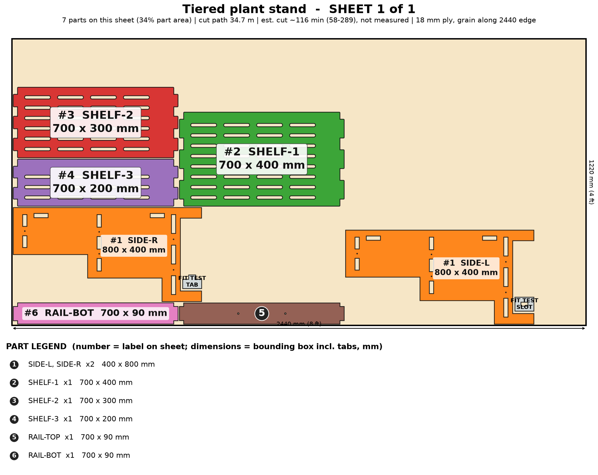

# Tiered Plant Stand

A stepped plant stand cut to your window or wall: 2 to 4 slatted shelves, raised for the robot vacuum, with an anti-tip anchor.

> Planning numbers are ESTIMATES / ASSUMPTIONS. Machine times are estimates (sourced range, not measured; see ../CUT-SPEED-RESEARCH.md). Run the fit-test coupon (on sheet 1) before cutting a full sheet.

## Size
Overall 700 W x 400 D x 800 H mm. 1 sheet(s) of 4x8 (1220 x 2440 mm) 18 mm ply, cut path 34.7 m.

## Parameters (edit `PARAMS` at the top of `model.py`)
| Parameter | Default | Sane limits |
|---|---|---|
| `width` | 700.0 | 400-900 mm |
| `height` | 800.0 | 500-1100 mm (anchor above 900) |
| `depth` | 400.0 | 250-500 mm |
| `tiers` | 3 | 2-4 (>= 200 mm clear between shelves) |
| `step` | 100.0 | 60-140 mm (top tier >= 150 deep) |
| `thickness` | 18.0 | 17.5-19 mm |
| `clearance` | 0.1 | 0.0-0.2 mm |
| `plinth` | 90.0 | 90-150 mm (0 = floor standing) |
| `slatted` | 1 | 0 or 1 |

Regenerate everything with `cd furniture-v2 && /workspace/venv-egg/bin/python run.py plant-stand` (writes DXFs, sheet PNGs, assembly.png, parts.json, plan.json, checks.txt). The run also builds two stress variants of the parameters and checks them.

## Joinery
Through-tab joints, slot = tab + 0.1 mm each way; #8 screws with 3.0 mm pilots; Titebond III glue with the screws acting as clamps; 6 mm minimum spacing between nested parts.

Stair-profile sides carry the shelves through slots; two rear rails keep it square and the top rail has 2 anti-tip strap holes (6 mm). Drainage slots in every shelf. Outdoors use exterior-grade ply. No French cleat: a plant stand stands on its feet and is strapped to the wall instead.

## Cut sheets
### Sheet 1  (`plant-stand-nest-sheet1-1220x2440.dxf`, `sheet-1.png`)

Parts: SIDE-L 400x800, SIDE-R 400x800, SHELF-1 700x400, SHELF-2 700x300, SHELF-3 700x200, RAIL-TOP 700x90, RAIL-BOT 700x90

## Build stages (420 min total, estimate)
| # | Stage | min | What |
|---|---|---|---|
| 1 | Cut the sheet | 231 | Run the fit-test coupon (slot = tab + 0.1 mm), then cut 1 sheet from the DXF (CUT layer): 35 m of path, 68 drainage slots. Inside-out order, air assist on. If the ply is exterior/marine grade, expect the phenolic glue lines to char more: slow down and test a scrap. |
| 2 | Remove char and sand | 40 | Brush char from every edge, 120 then 180 grit; ease the shelf edges. Sand the drainage slots with a folded strip of paper. |
| 3 | Dry fit | 12 | Lay SIDE-L flat, push the 3 SHELF boards and the two rails into its slots, add SIDE-R. Check each shelf tab ends flush with the outside face and the stair profile lines up. No glue. |
| 4 | Pre-finish | 60 | Seal every face and edge now: 3 coats of spar urethane or exterior poly (wet pots, spills). Mask tabs and slots so the glue still bonds. Seal the drainage slot edges well; they take the water. |
| 5 | Glue-up (Titebond III, water-resistant) | 25 | Glue the 3 shelf tabs and the two rail tabs into SIDE-L, then fit SIDE-R and clamp across the width. Wipe squeeze-out at once; check square by measuring both diagonals. |
| 6 | Screws as clamps | 12 | 10 #8 screws (3.0 mm pilots pre-cut): #8 x 1-1/2 in through the side faces into the shelf edges, between the tabs. Use coated or stainless screws if it will live outdoors. |
| 7 | Anti-tip anchor | 10 | Fit the anti-tip strap through one of the two 6 mm holes in RAIL-TOP into a wall stud. Heavy pots on the top tier raise the tipping risk, so keep the heaviest pots on the bottom tier. |
| 8 | Final coat, cure, pack | 30 | Last coat on the top faces, 24 h cure, 15 kg pot load test on each shelf, felt/rubber pads on the 4 feet, flat-pack in one box (about 720 x 820 x 80 mm). |

## Materials and hardware
Sheet: 18 mm (3/4 in) birch or Baltic-birch plywood, 4 x 8 ft (1220 x 2440 mm) x 1; use exterior-grade ply for a patio stand

| Item | Qty | Unit $ (est.) | Note |
|---|---|---|---|
| #8 x 1-1/2 in wood screws (coated/stainless) | 10 | 0.1 | from model |
| Anti-tip furniture strap kit | 1 | 6.0 | mandatory above 900 mm; recommended always |
| Wood plugs / filler | 1 | 2.0 |  |
| Felt/rubber foot pads | 4 | 0.4 |  |

Glue: Titebond III, about 3 oz. Finish: spar urethane or exterior poly, 3 coats (about $14).

## Profit estimate (ESTIMATES / ASSUMPTIONS)
All dollar figures are planning ESTIMATES / ASSUMPTIONS, not quotes, not guaranteed. Sheet prices: 4x8 ft 18 mm birch plywood $70-110, basic plywood $55-75 (assumption). Machine time uses a sourced RANGE for a 120 W diode on 18 mm ply (low 120 / typical 300 / high 600 mm/min effective, i.e. after multiple passes; see CUT-SPEED-RESEARCH.md); ACMER publishes no 18 mm ply feed rate, so none of it is measured on this machine. Machine wear/electricity $1.70 per machine-hour (assumption). Labor valued at $25/h for the "after labor" line only. Marketplace fees 10% (assumption, e.g. Etsy-style).

Price band source: My estimate: Etsy/Amazon plywood plant stands run about $30-$110 for small units (SHORTLIST.md R1, third-party estimates); a window- or wall-fitted 3-tier unit with slatted shelves, finished, is priced above that. Low = 2-tier unfinished, high = 4-tier finished and sized to order.

| | Low | Mid | High |
|---|---|---|---|
| Price | $95 | $165 | $250 |
| COGS (sheets at mid + hardware + finish + packaging + machine wear) | $128 | $128 | $128 |
| Gross margin | $-33 (-35%) | $37 (22%) | $122 (49%) |
| Gross margin if you absorb shipping (est. $34) | $-67 | $3 | $88 |
| Net after 10% fees and labor | $-93 | $-30 | $47 |

### Machine time and profit per machine hour (ESTIMATE, at the mid price; includes 15 min/sheet of load, focus and unload, rapid travel between 110 contours)
| Scenario | Effective rate | Machine hours per unit | COGS | Gross margin | Gross margin per machine hour | Net after fees+labor per machine hour |
|---|---|---|---|---|---|---|
| Diode, slow case | 120 mm/min (5 pass x 600 mm/min) | 5.2 | $133 | $32 | $6 | $-7 |
| Diode, typical | 300 mm/min (4 pass x 1200 mm/min) | 2.3 | $128 | $37 | $16 | $-13 |
| Diode, best case | 600 mm/min (2 pass x 1200 mm/min) | 1.3 | $127 | $38 | $30 | $-22 |
| Commercial CO2 300-600 W (sourced) | 600 mm/min (1 pass x 600 mm/min) | 1.1 | $133 | $32 | $30 | $-33 |
| What-if 10x faster than diode typical (assumption) | x10 on diode typical cut+travel | 0.3 | $127 | $38 | $131 | $-98 |
| What-if 20x faster (assumption) | x20 on diode typical cut+travel | 0.2 | $126 | $39 | $205 | $-145 |

ESTIMATE: 2.3 h (low-speed case 5.2 h, best case 1.3 h) of machine time per unit for 35 m of cut path in 1 sheet(s) on a 120 W diode, 18 mm plywood. Machine time, not material, is still the limit on profit per hour, but a single test cut on scrap will replace this range with a real number.

ASSUMPTION. Sourced case: 300-600 W CO2 flatbed, single pass at ~600 mm/min (vendor 480-720), 60 m/min rapids, 5 min/sheet, $8/h operating cost. What-if cases: a machine 10x / 20x faster than the diode mid cut+travel time (not sourced for 18 mm ply).

Sources and method: ../CUT-SPEED-RESEARCH.md.

## Safety
- Anchor to a wall stud with the anti-tip strap (ASTM F3096 style); mandatory above 900 mm, recommended on every unit.
- Rated target 15 kg per shelf (UNVERIFIED - load test a shelf before selling). Wet soil is heavy: 5 L of damp potting mix is about 4 kg.
- Not a children's product (no CPSIA testing). Not a climbing aid.
- Outdoor use needs exterior-grade ply plus a UV-rated finish; indoor-grade birch ply swells and delaminates when wet.

## Unverified / caveats
- Machine time is an estimate (120 W diode on 18 mm ply, sourced range, not measured on this machine); cut time and profit/hour depend on it.
- Shelf load rating and deflection untested; the deflection line in checks.txt is a hand calculation with an assumed ply modulus.
- Exterior/marine ply (phenolic glue) cut quality on the diode laser is unverified.
- The cost model charges one whole 4x8 sheet but this design fills only 34% of it (offcut not credited). Nesting 2 stands per sheet (area allows it; not nested here) would cut mid cost to about $83 and lift mid gross margin from 22% to about 49%. As modeled, the low price band is below cost.
- Price band is my estimate, not a market quote.

## Verification
See `checks.txt` (assembled-model overlap/containment, nest overlap, DXF read-back).
