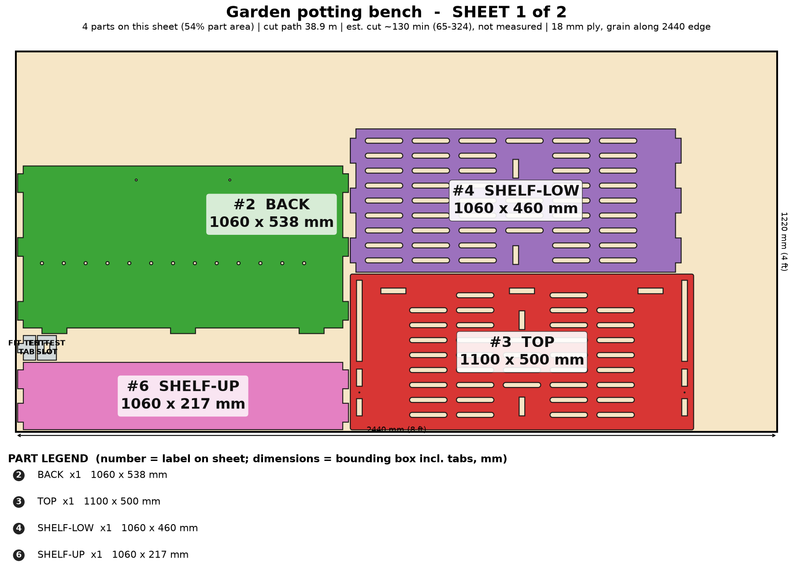
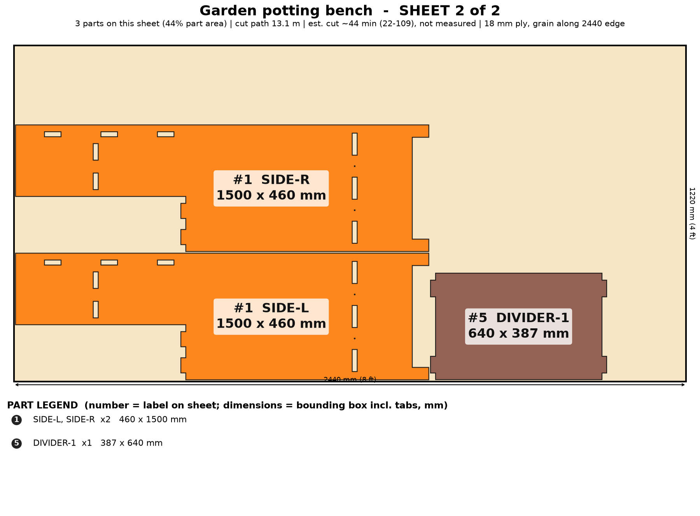

# Garden Potting Bench

A potting bench with a drainage worktop, a lower shelf and a hutch shelf with tool-hang holes, built from exterior-grade ply and raised off wet ground. Cut to your patio or greenhouse.

> Planning numbers are ESTIMATES / ASSUMPTIONS. Machine times are estimates (sourced range, not measured; see ../CUT-SPEED-RESEARCH.md). Run the fit-test coupon (on sheet 1) before cutting a full sheet.

## Size
Overall 1100 W x 500 D x 1500 H mm. 2 sheet(s) of 4x8 (1220 x 2440 mm) 18 mm ply, cut path 52.0 m.

## Parameters (edit `PARAMS` at the top of `model.py`)
| Parameter | Default | Sane limits |
|---|---|---|
| `width` | 1100.0 | 700-1600 mm (each bay <= 700) |
| `height` | 900.0 | 750-1000 mm |
| `depth` | 500.0 | 420-600 mm |
| `hutch_top` | 1500.0 | 1250-1800 mm |
| `hutch_depth` | 260.0 | 210-320 mm |
| `hutch_shelf_z` | 1200.0 | >= worktop height + 250 |
| `shelf_z` | 260.0 | >= foot + 60 mm |
| `foot` | 60.0 | 40-120 mm |
| `dividers` | 1 | 0-2 (each bay <= 700) |
| `slatted` | 1 | 0 or 1 |
| `thickness` | 18.0 | 17.5-19 mm |
| `clearance` | 0.1 | 0.0-0.2 mm (keep >= 0.1 outdoors) |

Regenerate everything with `cd furniture-v2 && /workspace/venv-egg/bin/python run.py potting-bench` (writes DXFs, sheet PNGs, assembly.png, parts.json, plan.json, checks.txt). The run also builds two stress variants of the parameters and checks them.

## Joinery
Through-tab joints, slot = tab + 0.1 mm each way; #8 screws with 3.0 mm pilots; Titebond III glue with the screws acting as clamps; 6 mm minimum spacing between nested parts.

Outdoor build: exterior-grade ply, feet off the ground, drainage slots in the worktop and lower shelf. The L-shaped sides pass through long slots in the worktop and carry the hutch shelf and the back panel; back panel has 10 mm tool-hang holes and 2 anti-tip strap holes. Folding variant not modeled (knock-down by omitting glue is unverified).

## Cut sheets
### Sheet 1  (`potting-bench-nest-sheet1-1220x2440.dxf`, `sheet-1.png`)

Parts: TOP 1100x500, SHELF-LOW 1060x460, BACK 1060x538, SHELF-UP 1060x217

### Sheet 2  (`potting-bench-nest-sheet2-1220x2440.dxf`, `sheet-2.png`)

Parts: SIDE-L 460x1500, SIDE-R 460x1500, DIVIDER-1 387x640

## Build stages (667 min total, estimate)
| # | Stage | min | What |
|---|---|---|---|
| 1 | Cut the sheets | 347 | Run the fit-test coupon first (slot = tab + 0.1 mm; do not tighten it for outdoor ply, which swells), then cut 2 sheets from the DXFs (CUT layer): 52 m of path, 87 drainage slots, 13 tool-hang holes. Inside-out order, air assist on. Exterior-grade ply has more glue lines: expect more char, and test a scrap. |
| 2 | Remove char and sand | 60 | Brush the char from every edge, 120 then 180 grit; round over the worktop edge. End grain drinks water: sand the slot edges smooth now so the sealer can soak in. |
| 3 | Dry fit | 20 | Stand SIDE-L flat, push in SHELF-LOW, the 1 divider(s), BACK and SHELF-UP, add SIDE-R, then lower the TOP over the uprights and every tab. Check square. No glue. |
| 4 | Seal every face and edge | 120 | Outdoors the finish is the product: 3 coats of exterior spar urethane, or 2 coats of penetrating epoxy sealer then 2 coats of exterior paint, on every face and edge, including the insides of the drainage slots. Mask the tabs and slots so the glue still bonds (a dry run first). Do this before glue-up. |
| 5 | Glue-up (Titebond III, water-resistant) | 40 | Glue SHELF-LOW, the divider(s), BACK and SHELF-UP into SIDE-L, fit SIDE-R and clamp. Then lower the TOP over the tabs and the two uprights. Wipe squeeze-out at once. Titebond III is rated water-resistant (exterior use under cover); it is not for standing water. |
| 6 | Screws as clamps | 20 | 6 #8 x 1-1/2 in stainless or coated deck screws (3.0 mm pilots cut in): through the side faces into the lower shelf edges and down through the TOP into the side edges (plug and seal the heads). For a knock-down bench omit the glue and use the screws only (weaker; unverified). |
| 7 | Wall anchor | 15 | Strap the BACK to the wall through one of the two 6 mm holes near its top (stud or masonry anchor). Required: this piece is 1500 mm tall and holds wet soil. |
| 8 | Hooks, test, pack | 45 | Fit S-hooks or 10 mm dowel pegs in the tool-hang holes. Load-test 40 kg on the worktop and 25 kg on the lower shelf. Feet pads on all 4 feet. Flat-pack in two boxes (long parts about 1.55 m). |

## Materials and hardware
Sheet: 18 mm (3/4 in) EXTERIOR-grade plywood (exterior glue, e.g. exterior birch/fir or marine okoume for wet sites), 4 x 8 ft (1220 x 2440 mm) x 2

| Item | Qty | Unit $ (est.) | Note |
|---|---|---|---|
| #8 x 1-1/2 in stainless/coated screws | 6 | 0.15 | from model; stainless for coastal/wet sites |
| Wall anchor strap / bracket kit (stud + masonry) | 1 | 8.0 | mandatory |
| S-hooks or 10 mm dowel pegs | 6 | 0.8 | for the tool-hang holes |
| Wood plugs / filler (exterior) | 1 | 3.0 |  |
| Rubber foot pads | 4 | 0.6 |  |

Glue: Titebond III, about 6 oz. Finish: exterior spar urethane or epoxy-sealer plus exterior paint (about $34 for the whole bench).

## Profit estimate (ESTIMATES / ASSUMPTIONS)
All dollar figures are planning ESTIMATES / ASSUMPTIONS, not quotes, not guaranteed. Sheet prices: 4x8 ft 18 mm birch plywood $70-110, basic plywood $55-75 (assumption). Machine time uses a sourced RANGE for a 120 W diode on 18 mm ply (low 120 / typical 300 / high 600 mm/min effective, i.e. after multiple passes; see CUT-SPEED-RESEARCH.md); ACMER publishes no 18 mm ply feed rate, so none of it is measured on this machine. Machine wear/electricity $1.70 per machine-hour (assumption). Labor valued at $25/h for the "after labor" line only. Marketplace fees 10% (assumption, e.g. Etsy-style).

Price band source: My estimate: Amazon/Home Depot garden potting benches run about $90-$250 (thin fir/steel), handmade cedar or ply benches about $250-$700 (Etsy; SHORTLIST.md R2 outdoor planter/bench). A sealed exterior-ply bench cut to size, with hutch and hooks, sits in the handmade tier. Low = balcony size unpainted, high = 1.6 m greenhouse size painted.

| | Low | Mid | High |
|---|---|---|---|
| Price | $260 | $420 | $650 |
| COGS (sheets at mid + hardware + finish + packaging + machine wear) | $261 | $261 | $261 |
| Gross margin | $-1 (-0%) | $159 (38%) | $389 (60%) |
| Gross margin if you absorb shipping (est. $80) | $-81 | $79 | $309 |
| Net after 10% fees and labor | $-112 | $32 | $239 |

### Machine time and profit per machine hour (ESTIMATE, at the mid price; includes 15 min/sheet of load, focus and unload, rapid travel between 147 contours)
| Scenario | Effective rate | Machine hours per unit | COGS | Gross margin | Gross margin per machine hour | Net after fees+labor per machine hour |
|---|---|---|---|---|---|---|
| Diode, slow case | 120 mm/min (5 pass x 600 mm/min) | 8.0 | $269 | $151 | $19 | $3 |
| Diode, typical | 300 mm/min (4 pass x 1200 mm/min) | 3.6 | $261 | $159 | $44 | $9 |
| Diode, best case | 600 mm/min (2 pass x 1200 mm/min) | 2.0 | $259 | $161 | $80 | $17 |
| Commercial CO2 300-600 W (sourced) | 600 mm/min (1 pass x 600 mm/min) | 1.6 | $268 | $152 | $94 | $15 |
| What-if 10x faster than diode typical (assumption) | x10 on diode typical cut+travel | 0.5 | $259 | $161 | $343 | $73 |
| What-if 20x faster (assumption) | x20 on diode typical cut+travel | 0.3 | $258 | $162 | $507 | $110 |

ESTIMATE: 3.6 h (low-speed case 8.0 h, best case 2.0 h) of machine time per unit for 52 m of cut path in 2 sheet(s) on a 120 W diode, 18 mm plywood. Machine time, not material, is still the limit on profit per hour, but a single test cut on scrap will replace this range with a real number.

ASSUMPTION. Sourced case: 300-600 W CO2 flatbed, single pass at ~600 mm/min (vendor 480-720), 60 m/min rapids, 5 min/sheet, $8/h operating cost. What-if cases: a machine 10x / 20x faster than the diode mid cut+travel time (not sourced for 18 mm ply).

Sources and method: ../CUT-SPEED-RESEARCH.md.

## Safety
- Anchor the BACK to the wall (anti-tip strap or bracket); mandatory, the bench is 1500 mm tall and carries wet soil.
- Rated target 40 kg on the worktop and 25 kg on the lower shelf, UNVERIFIED - load test before selling; wet soil is about 1.3 kg per litre.
- Use exterior-grade ply only; interior ply delaminates outdoors within a season. Seal every edge.
- Not a children's product (no CPSIA testing); do not use as a ladder or step.
- Keep it off standing water and treat the feet pads as wear parts.

## Unverified / caveats
- Machine time is an estimate (120 W diode on 18 mm ply, sourced range, not measured on this machine); cut time and profit/hour depend on it.
- Exterior and marine plywood (phenolic/waterproof glue lines) cut quality and speed on the 120 W diode are unverified; the laser may need more passes or leave heavier char.
- Weather life of the finish and of the tab joints is untested; swelling can bind tabs, so the 0.1 mm slot clearance should not be tightened.
- A folding version is not modeled; knock-down (screws, no glue) is possible but unverified and weaker.
- French cleat not offered: the piece is heavy, wet and meant to stand on its feet.
- Price band is my estimate, not a market quote. Low and high bands are applied to the default-size cost, so the low band is about break-even; a balcony-size unit costs less in material.

## Verification
See `checks.txt` (assembled-model overlap/containment, nest overlap, DXF read-back).
