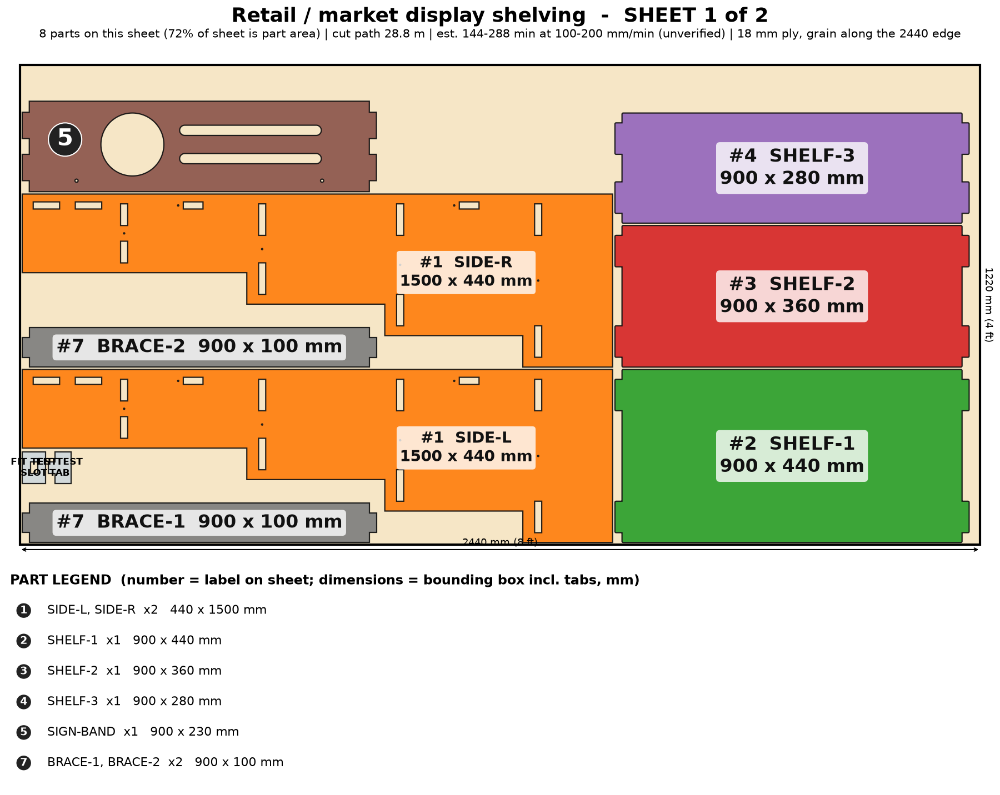
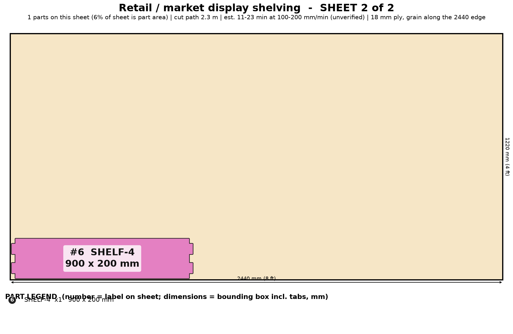

# Retail / Market Display Shelving

Tiered booth shelving that knocks down flat: stepped sides, 4 shelves, a sign band with your logo cut into it, no glue.

> Planning numbers are ESTIMATES / ASSUMPTIONS. Machine feed 100-200 mm/min is unverified. Run the fit-test coupon (on sheet 1) before cutting a full sheet.

## Size
Overall 900 W x 440 D x 1500 H mm. 2 sheet(s) of 4x8 (1220 x 2440 mm) 18 mm ply, cut path 31.1 m.

## Parameters (edit `PARAMS` at the top of `model.py`)
| Parameter | Default | Sane limits |
|---|---|---|
| `width` | 900.0 | 500-1300 mm (centre divider over 1000) |
| `height` | 1500.0 | 900-1900 mm |
| `thickness` | 18.0 | 17.5-19 mm |
| `clearance` | 0.1 | 0.0-0.2 mm |
| `tiers` | 4 | 3-6 |
| `base_depth` | 440.0 | 300-520 mm |
| `step` | 80.0 | 50-100 mm (top shelf >= 160) |
| `first_z` | 180.0 | 120-300 mm |
| `sign_h` | 230.0 | 150-350 mm (0 = no band) |
| `logo` | 1 | 0 or 1 |

Regenerate everything with `cd furniture-v2 && /workspace/venv-egg/bin/python run.py retail-display` (writes DXFs, sheet PNGs, assembly.png, parts.json, plan.json, checks.txt). The run also builds two stress variants of the parameters and checks them.

## Joinery
Through-tab joints, slot = tab + 0.1 mm each way; #8 screws with 3.0 mm pilots; Titebond III glue with the screws acting as clamps; 6 mm minimum spacing between nested parts.

Knock-down stepped display, screws only. The stair-profile sides are nested by bounding box, so there is a second, nearly empty sheet. Logo is a placeholder cut-out (circle plus two bars). Folding variant not modeled.

## Cut sheets
### Sheet 1  (`retail-display-nest-sheet1-1220x2440.dxf`, `sheet-1.png`)

Parts: SIDE-L 440x1500, SIDE-R 440x1500, SHELF-1 900x440, SHELF-2 900x360, SHELF-3 900x280, BRACE-1 900x100, BRACE-2 900x100, SIGN-BAND 900x230

### Sheet 2  (`retail-display-nest-sheet2-1220x2440.dxf`, `sheet-2.png`)

Parts: SHELF-4 900x200

## Build stages (417 min total, estimate)
| # | Stage | min | What |
|---|---|---|---|
| 1 | Cut the sheets | 207 | Fit-test coupon first (slot = tab + 0.1 mm); cut 2 sheet(s): 31 m of path. Replace the logo placeholder in sheet 1 (CUT layer) with the customer artwork: keep every letter island tied with a 3 mm bridge. Inside-out order, air assist on. |
| 2 | Remove char and sand | 60 | Brush off the char, 120 then 180 grit; ease the shelf front edges and the logo opening. Wipe clean. |
| 3 | Dry fit | 20 | Lay SIDE-L flat, push the 4 shelves, 2 braces and the sign band into their slots, add SIDE-R. Check the tab ends are flush and that the unit stands without rocking. |
| 4 | Finish all parts flat | 60 | Oil or poly all faces and edges flat (fast), mask the tab and slot surfaces only if you want them to be glued later. Brand colour or stain on the sign band if ordered. |
| 5 | Test-assemble with screws | 20 | NO GLUE: it is knock-down. Drive 12 #8 x 1-1/2 in screws (3.0 mm pilots pre-cut) through the side faces into the shelf and brace edges. Re-removable for flat storage. |
| 6 | Stability check | 15 | Tip test with every shelf loaded (see the load rating): it must not tip at a 10 deg lean. Fit the 2 anchor holes in the sign band with a wall strap or hang a 5 kg ballast bag on the bottom shelf for outdoor use. |
| 7 | Knock down and flat-pack | 25 | Unscrew, stack the 4 shelves, braces and band between the two sides with cardboard spacers, add the screws in a labelled bag and the 1-page assembly sheet; 1.5 m x 0.5 m x 0.2 m box. |
| 8 | Customer assembly (about 10 min) | 10 | Customer lays one side flat, slides in shelves and braces, adds the second side and drives the 12 screws with a Phillips/Torx driver. No glue, no clamps. |

## Materials and hardware
Sheet: 18 mm (3/4 in) Baltic-birch or birch plywood, 4 x 8 ft x 2 (paulownia/light ply for carry-friendly sets)

| Item | Qty | Unit $ (est.) | Note |
|---|---|---|---|
| #8 x 1-1/2 in wood screws (incl. spares) | 16 | 0.06 | from model |
| Ballast bag / wall strap | 1 | 5.0 | anchor |
| Felt/rubber foot pads | 4 | 0.4 |  |
| Assembly sheet + cardboard spacers | 1 | 2.0 |  |

Glue: Titebond III, about none (screw-together). Finish: water-based poly or hardwax oil; stain or paint the band in brand colour (about $14).

## Profit estimate (ESTIMATES / ASSUMPTIONS)
All dollar figures are planning ESTIMATES / ASSUMPTIONS, not quotes, not guaranteed. Sheet prices: 4x8 ft 18 mm birch plywood $70-110, basic plywood $55-75 (assumption). Machine feed 100-200 mm/min is an UNVERIFIED estimate (ACMER publishes no 18 mm ply feed rate). Machine wear/electricity $1.70 per machine-hour (assumption). Labor valued at $25/h for the "after labor" line only. Marketplace fees 10% (assumption, e.g. Etsy-style).

Price band source: SHORTLIST.md: Etsy/web listings $180-$1,100, four-tier A-frame ~$570; custom target $200-$800 (estimate)

| | Low | Mid | High |
|---|---|---|---|
| Price | $200 | $500 | $800 |
| COGS (sheets at mid + hardware + finish + packaging + machine wear) | $231 | $231 | $231 |
| Gross margin | $-31 (-16%) | $269 (54%) | $569 (71%) |
| Gross margin if you absorb shipping (est. $67) | $-98 | $202 | $502 |
| Net after 10% fees and labor | $-106 | $164 | $434 |
| Gross margin per machine hour | $-9 | $78 | $165 |

Machine time 3.5 h per unit at mid feed (311/207/155 min at 100/150/200 mm/min). At 100-200 mm/min the laser path alone is 2.6-5.2 machine hours per unit; machine time, not material, is the bottleneck. Verify the real feed on scrap before quoting.

## Safety
- Target load per shelf 15 kg, bottom shelf 25 kg - UNVERIFIED; load-test one unit.
- Tall and shallow at the top: strap to a wall indoors or add 5 kg ballast outdoors (wind). Do not let customers climb it.
- Keep heavy product on the bottom tiers; the top tier is for light items only.
- Not a children's product.

## Unverified / caveats
- Load rating and tip angle untested.
- Folding variant is not modeled (this is knock-down only).
- Laser feed 100-200 mm/min is an estimate.
- Logo cut-out is a placeholder; customer artwork needs bridges for letter islands.
- Price band is an estimate from SHORTLIST.md (the repeat B2B reorders are the draw, not a measured demand).

## Verification
See `checks.txt` (assembled-model overlap/containment, nest overlap, DXF read-back).
