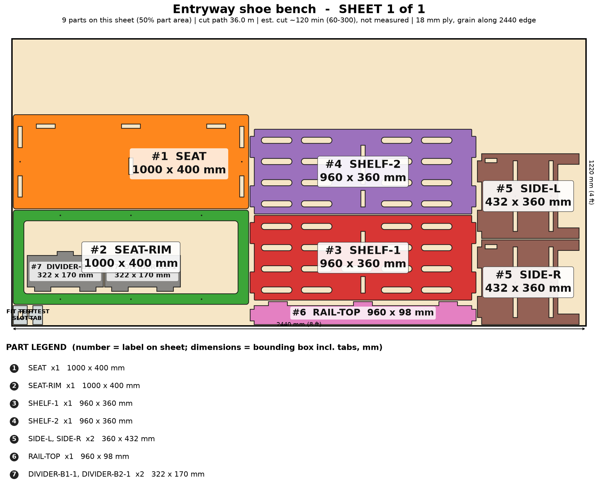

# Entryway Shoe Bench

A seat plus shoe storage in one flat-pack: slatted shelves, a laser-cut cushion recess, raised so the robot vacuum goes underneath.

> Planning numbers are ESTIMATES / ASSUMPTIONS. Machine times are estimates (sourced range, not measured; see ../CUT-SPEED-RESEARCH.md). Run the fit-test coupon (on sheet 1) before cutting a full sheet.

## Size
Overall 1000 W x 400 D x 450 H mm. 1 sheet(s) of 4x8 (1220 x 2440 mm) 18 mm ply, cut path 36.0 m.

## Parameters (edit `PARAMS` at the top of `model.py`)
| Parameter | Default | Sane limits |
|---|---|---|
| `width` | 1000.0 | 600-1400 mm (2 dividers over 1000) |
| `height` | 450.0 | 380-520 mm |
| `depth` | 400.0 | 300-480 mm |
| `thickness` | 18.0 | 17.5-19 mm |
| `clearance` | 0.1 | 0.0-0.2 mm |
| `plinth` | 90.0 | 90-150 mm |
| `shelves` | 2 | 1-3 (bay >= 120 mm) |
| `dividers` | 1 | 0-2 |
| `cushion_recess` | 1 | 0 or 1 |
| `slatted` | 1 | 0 or 1 |
| `cleat` | 1 | 0 or 1 |

Regenerate everything with `cd furniture-v2 && /workspace/venv-egg/bin/python run.py shoe-bench` (writes DXFs, sheet PNGs, assembly.png, parts.json, plan.json, checks.txt). The run also builds two stress variants of the parameters and checks them.

## Joinery
Through-tab joints, slot = tab + 0.1 mm each way; #8 screws with 3.0 mm pilots; Titebond III glue with the screws acting as clamps; 6 mm minimum spacing between nested parts.

Slatted shelves vent wet shoes. The cushion recess is a glued frame (laser only). The seat rests on side tabs plus dividers; the cleat option is for the shoe shelf only, not for sitting.

## Cut sheets
### Sheet 1  (`shoe-bench-nest-sheet1-1220x2440.dxf`, `sheet-1.png`)

Parts: SEAT 1000x400, SIDE-L 360x432, SIDE-R 360x432, SHELF-1 960x360, SHELF-2 960x360, RAIL-TOP 960x98, DIVIDER-B1-1 322x170, DIVIDER-B2-1 322x170, SEAT-RIM 1000x400

## Build stages (480 min total, estimate)
| # | Stage | min | What |
|---|---|---|---|
| 1 | Cut the sheet(s) | 240 | Run the fit-test coupon (slot = tab + 0.1 mm), then cut 1 sheet(s) from the DXFs (CUT layer): 36 m of path, 33 slotted vents in the shelves. Inside-out order, air assist on. |
| 2 | Remove char and sand | 55 | Brush the char from every cut edge, 120 then 180 grit; ease the seat edge to a 3 mm round-over by hand; sand the vent slots with a folded strip of paper. |
| 3 | Dry fit | 15 | Stand the SIDES, slide in the 2 SHELF board(s), dividers, RAIL-TOP, then the SEAT. Check tab ends are flush and the case is square; no glue. |
| 4 | Pre-finish | 45 | Seal all faces now (poly or hardwax oil) - shoes are wet and dirty. Mask the tabs and slots so the glue still bonds. |
| 5 | Glue-up (Titebond III) | 30 | Glue the dividers into the shelves, then the shelves into SIDE-L, add SIDE-R, RAIL-TOP, and finally seat the SEAT over all top tabs. Clamp across the width; wipe squeeze-out. |
| 6 | Screws as clamps | 20 | 6 #8 screws (3.0 mm pilots pre-cut): #8 x 1-1/2 in through the side faces into the shelf edges and down through the seat into the side edges (hidden under the frame); then 6 x #8 x 1-1/4 in down through SEAT-RIM into the seat. |
| 7 | Cushion frame | 15 | Glue and screw SEAT-RIM on the seat (covers the tab ends). The recess holds a cushion up to about 45 mm thick, size = opening printed on sheet 1. Cut the cushion board from the offcut if wanted. |
| 8 | Optional cleat / wall hang | 20 | For a floating SHOE SHELF version only: Z-bar cleat on the rear face of RAIL-TOP into studs. Do not use as a seat when wall-hung unless every cleat screw is in a stud and the wall half is rated (unverified). |
| 9 | Finish, load test, pack | 40 | Final coat on the seat, 24 h cure, sit-test with 120 kg, felt pads on the 4 feet, flat-pack in one box with corner guards. |

## Materials and hardware
Sheet: 18 mm (3/4 in) sanded plywood (basic birch-faced or cabinet ply), 4 x 8 ft x 1; use hardwood ply for a premium version

| Item | Qty | Unit $ (est.) | Note |
|---|---|---|---|
| #8 x 1-1/2 in wood screws | 6 | 0.06 | from model |
| #8 x 1-1/4 in wood screws | 6 | 0.06 | frame to seat |
| Aluminum Z-bar cleat pair | 1 | 12.0 | optional, shoe shelf only |
| Seat cushion 1-2 in foam + cover (optional, sold separately) | 0 | 0.0 | customer or add-on |
| Felt/rubber foot pads | 4 | 0.4 |  |
| Wood plugs | 1 | 2.0 |  |

Glue: Titebond III, about 3 oz. Finish: water-based poly (wet-area rated), 2 coats (about $9).

## Profit estimate (ESTIMATES / ASSUMPTIONS)
All dollar figures are planning ESTIMATES / ASSUMPTIONS, not quotes, not guaranteed. Sheet prices: 4x8 ft 18 mm birch plywood $70-110, basic plywood $55-75 (assumption). Machine time uses a sourced RANGE for a 120 W diode on 18 mm ply (low 120 / typical 300 / high 600 mm/min effective, i.e. after multiple passes; see CUT-SPEED-RESEARCH.md); ACMER publishes no 18 mm ply feed rate, so none of it is measured on this machine. Machine wear/electricity $1.70 per machine-hour (assumption). Labor valued at $25/h for the "after labor" line only. Marketplace fees 10% (assumption, e.g. Etsy-style).

Price band source: SHORTLIST.md: custom target $140-$300 (estimate); Amazon typical ~$75, Etsy $129-$190 [third-party estimates]

| | Low | Mid | High |
|---|---|---|---|
| Price | $140 | $220 | $300 |
| COGS (sheets at mid + hardware + finish + packaging + machine wear) | $104 | $104 | $104 |
| Gross margin | $36 (26%) | $116 (53%) | $196 (65%) |
| Gross margin if you absorb shipping (est. $40) | $-4 | $76 | $156 |
| Net after 10% fees and labor | $-28 | $44 | $116 |

### Machine time and profit per machine hour (ESTIMATE, at the mid price; includes 15 min/sheet of load, focus and unload, rapid travel between 81 contours)
| Scenario | Effective rate | Machine hours per unit | COGS | Gross margin | Gross margin per machine hour | Net after fees+labor per machine hour |
|---|---|---|---|---|---|---|
| Diode, slow case | 120 mm/min (5 pass x 600 mm/min) | 5.4 | $110 | $110 | $20 | $7 |
| Diode, typical | 300 mm/min (4 pass x 1200 mm/min) | 2.4 | $104 | $116 | $49 | $18 |
| Diode, best case | 600 mm/min (2 pass x 1200 mm/min) | 1.3 | $103 | $117 | $90 | $35 |
| Commercial CO2 300-600 W (sourced) | 600 mm/min (1 pass x 600 mm/min) | 1.1 | $109 | $111 | $102 | $36 |
| What-if 10x faster than diode typical (assumption) | x10 on diode typical cut+travel | 0.3 | $103 | $117 | $405 | $156 |
| What-if 20x faster (assumption) | x20 on diode typical cut+travel | 0.2 | $102 | $118 | $622 | $243 |

ESTIMATE: 2.4 h (low-speed case 5.4 h, best case 1.3 h) of machine time per unit for 36 m of cut path in 1 sheet(s) on a 120 W diode, 18 mm plywood. Machine time, not material, is still the limit on profit per hour, but a single test cut on scrap will replace this range with a real number.

ASSUMPTION. Sourced case: 300-600 W CO2 flatbed, single pass at ~600 mm/min (vendor 480-720), 60 m/min rapids, 5 min/sheet, $8/h operating cost. What-if cases: a machine 10x / 20x faster than the diode mid cut+travel time (not sourced for 18 mm ply).

Sources and method: ../CUT-SPEED-RESEARCH.md.

## Safety
- Seat load rating target 120 kg (265 lb) - UNVERIFIED, load test every design change (sag test at the seat centre).
- The center divider(s) carry the seat; do not omit them on benches wider than 800 mm.
- Wall-hung (cleat) use: shoe shelf only unless studs and a rated cleat are used.
- Not a children's product (no CPSIA testing).

## Unverified / caveats
- Seat strength and deflection untested (18 mm ply over 1000 mm without dividers would sag about 12 mm at 100 kg by hand calculation).
- Machine time is an estimate (120 W diode on 18 mm ply, sourced range, not measured on this machine); cut time and profit/hour depend on it.
- Cushion fit depends on the cushion bought.
- Composite decking top is a CNC-only variant, not modeled here.
- Price band is an estimate from SHORTLIST.md.

## Verification
See `checks.txt` (assembled-model overlap/containment, nest overlap, DXF read-back).
