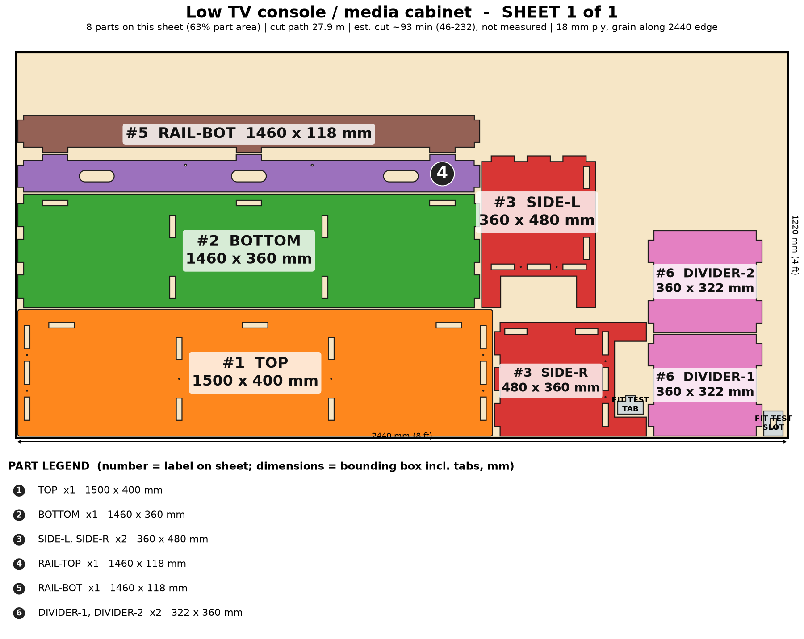

# Low TV Console / Media Cabinet

A long, low media console with open bays, rear cable slots and a cleat-ready rail, raised so the robot vacuum goes underneath. Cut to the width of your wall.

> Planning numbers are ESTIMATES / ASSUMPTIONS. Machine times are estimates (sourced range, not measured; see ../CUT-SPEED-RESEARCH.md). Run the fit-test coupon (on sheet 1) before cutting a full sheet.

## Size
Overall 1500 W x 400 D x 480 H mm. 1 sheet(s) of 4x8 (1220 x 2440 mm) 18 mm ply, cut path 27.9 m.

## Parameters (edit `PARAMS` at the top of `model.py`)
| Parameter | Default | Sane limits |
|---|---|---|
| `width` | 1500.0 | 900-2200 mm (bay <= 650) |
| `height` | 480.0 | 380-600 mm |
| `depth` | 400.0 | 300-480 mm |
| `thickness` | 18.0 | 17.5-19 mm |
| `clearance` | 0.1 | 0.0-0.2 mm |
| `plinth` | 100.0 | 90-150 mm (0 = floor standing) |
| `dividers` | 2 | 1-4 (each bay <= 650 mm) |
| `cable_slots` | 1 | 0 or 1 |
| `tv_max_kg` | 40.0 | 20-60 kg (hand calc only) |

Regenerate everything with `cd furniture-v2 && /workspace/venv-egg/bin/python run.py tv-console` (writes DXFs, sheet PNGs, assembly.png, parts.json, plan.json, checks.txt). The run also builds two stress variants of the parameters and checks them.

## Joinery
Through-tab joints, slot = tab + 0.1 mm each way; #8 screws with 3.0 mm pilots; Titebond III glue with the screws acting as clamps; 6 mm minimum spacing between nested parts.

Open bays between vertical dividers (each bay <= 650 mm so the 18 mm top does not sag). Rear top rail has one cable-pass slot per bay, 2 TV-strap holes and a 20 mm rear recess for an optional aluminum Z-bar cleat. Raised on feet for robot vacuums. No doors or drawers modeled.

## Cut sheets
### Sheet 1  (`tv-console-nest-sheet1-1220x2440.dxf`, `sheet-1.png`)

Parts: TOP 1500x400, SIDE-L 360x480, SIDE-R 360x480, BOTTOM 1460x360, RAIL-TOP 1460x118, RAIL-BOT 1460x118, DIVIDER-1 322x360, DIVIDER-2 322x360

## Build stages (426 min total, estimate)
| # | Stage | min | What |
|---|---|---|---|
| 1 | Cut the sheet(s) | 186 | Run the fit-test coupon first (slot = tab + 0.1 mm), then cut 1 sheet(s) from the DXFs (CUT layer): 28 m of path. Inside-out order, air assist on. The 1500 mm-class TOP and BOTTOM are the longest parts on the bed. |
| 2 | Remove char and sand | 55 | Brush char from the cut edges, 120 then 180 grit on faces and edges; ease the top corners. Wipe with a damp rag. |
| 3 | Dry fit | 15 | Stand SIDE-L and SIDE-R, push BOTTOM, the 2 divider(s) and both rails into place, then lower TOP over all the tabs. Check square and that TOP sits flat. No glue yet. |
| 4 | Pre-finish the inside faces | 45 | Seal / oil the bay faces and the rail faces before glue-up (mask tabs and slots so the glue still bonds). Two coats on all faces is easiest done flat. |
| 5 | Glue-up (Titebond III) | 35 | Lay SIDE-L flat. Glue and tap in BOTTOM, the divider(s), RAIL-BOT and RAIL-TOP, fit SIDE-R and clamp. Last, seat TOP on every tab with a few light taps from a block. Work in two halves if alone (10 minute open time). |
| 6 | Screws as clamps | 20 | 10 #8 x 1-1/2 in screws (3.0 mm pilots cut in): through each side face into the BOTTOM edge, and down through TOP into the side and divider edges. Countersink and plug the top screws. |
| 7 | Cable slots, TV strap, optional cleat | 25 | Feed cables through the 3 rear slots. Fit the TV anti-tip strap through the 6 mm holes in RAIL-TOP into a stud. Optional wall-hung version: Z-bar cleat across RAIL-TOP into studs; heavy (rated load unverified), so only with a proper stud-rated cleat and an empty-console test first. |
| 8 | Finish, test, pack | 45 | Two coats of water-based poly or hardwax oil, 24 h cure, 40 kg weight test on TOP, felt pads under the 4 feet, flat-pack in one 1.55 x 0.45 x 0.15 m box with corner guards. |

## Materials and hardware
Sheet: 18 mm (3/4 in) birch or Baltic-birch plywood, 4 x 8 ft (1220 x 2440 mm) x 1

| Item | Qty | Unit $ (est.) | Note |
|---|---|---|---|
| #8 x 1-1/2 in wood screws | 10 | 0.06 | from model |
| Anti-tip TV strap kit | 1 | 8.0 | TV to wall; recommended on every console |
| Aluminum Z-bar French cleat, 36 in pair | 1 | 14.0 | optional wall-hung version, studs only; laser cannot cut the 45 deg bevel |
| Wood plugs / filler | 1 | 2.0 |  |
| Felt/rubber foot pads | 4 | 0.4 |  |
| Grommets for cable slots (optional) | 3 | 1.0 |  |

Glue: Titebond III, about 5 oz. Finish: water-based poly or hardwax oil, 2 coats (about $16).

## Profit estimate (ESTIMATES / ASSUMPTIONS)
All dollar figures are planning ESTIMATES / ASSUMPTIONS, not quotes, not guaranteed. Sheet prices: 4x8 ft 18 mm birch plywood $70-110, basic plywood $55-75 (assumption). Machine time uses a sourced RANGE for a 120 W diode on 18 mm ply (low 120 / typical 300 / high 600 mm/min effective, i.e. after multiple passes; see CUT-SPEED-RESEARCH.md); ACMER publishes no 18 mm ply feed rate, so none of it is measured on this machine. Machine wear/electricity $1.70 per machine-hour (assumption). Labor valued at $25/h for the "after labor" line only. Marketplace fees 10% (assumption, e.g. Etsy-style).

Price band source: My estimate: Etsy/web plywood media consoles roughly $200-$700 and Amazon 55-65 in particle-board units about $120-$250 (third-party, not verified here). A wall-fitted solid-ply console with cable slots and bays is priced above the commodity units; low = 1200 mm unfinished, high = 2000 mm finished.

| | Low | Mid | High |
|---|---|---|---|
| Price | $240 | $380 | $560 |
| COGS (sheets at mid + hardware + finish + packaging + machine wear) | $156 | $156 | $156 |
| Gross margin | $84 (35%) | $224 (59%) | $404 (72%) |
| Gross margin if you absorb shipping (est. $56) | $28 | $168 | $348 |
| Net after 10% fees and labor | $-3 | $123 | $285 |

### Machine time and profit per machine hour (ESTIMATE, at the mid price; includes 15 min/sheet of load, focus and unload, rapid travel between 56 contours)
| Scenario | Effective rate | Machine hours per unit | COGS | Gross margin | Gross margin per machine hour | Net after fees+labor per machine hour |
|---|---|---|---|---|---|---|
| Diode, slow case | 120 mm/min (5 pass x 600 mm/min) | 4.2 | $160 | $220 | $52 | $28 |
| Diode, typical | 300 mm/min (4 pass x 1200 mm/min) | 1.9 | $156 | $224 | $118 | $65 |
| Diode, best case | 600 mm/min (2 pass x 1200 mm/min) | 1.1 | $155 | $225 | $210 | $116 |
| Commercial CO2 300-600 W (sourced) | 600 mm/min (1 pass x 600 mm/min) | 0.9 | $160 | $220 | $256 | $139 |
| What-if 10x faster than diode typical (assumption) | x10 on diode typical cut+travel | 0.2 | $155 | $225 | $899 | $497 |
| What-if 20x faster (assumption) | x20 on diode typical cut+travel | 0.2 | $155 | $225 | $1326 | $735 |

ESTIMATE: 1.9 h (low-speed case 4.2 h, best case 1.1 h) of machine time per unit for 28 m of cut path in 1 sheet(s) on a 120 W diode, 18 mm plywood. Machine time, not material, is still the limit on profit per hour, but a single test cut on scrap will replace this range with a real number.

ASSUMPTION. Sourced case: 300-600 W CO2 flatbed, single pass at ~600 mm/min (vendor 480-720), 60 m/min rapids, 5 min/sheet, $8/h operating cost. What-if cases: a machine 10x / 20x faster than the diode mid cut+travel time (not sourced for 18 mm ply).

Sources and method: ../CUT-SPEED-RESEARCH.md.

## Safety
- Strap the TV to the wall (anti-tip strap); a low console does not stop a TV tipping off it.
- Rated target 40 kg TV (88 lb) on the top, UNVERIFIED - load test one unit to 60 kg before selling; keep each bay <= 650 mm.
- Not a clothing-storage unit (STURDY Act applies to dressers >= 27 in); not a children's product (no CPSIA testing).
- Wall-hung (cleat) use only into studs with a stud-rated cleat; test empty then loaded.
- Keep AV gear ventilated: the open bays and rear slots are for that; do not box it in.

## Unverified / caveats
- Machine time is an estimate (120 W diode on 18 mm ply, sourced range, not measured on this machine); cut time and profit/hour depend on it.
- Top sag is a hand calculation (assumed ply modulus); a long span with a heavy TV needs a physical load test.
- Wall-hung cleat capacity of an aluminum Z-bar on a console this size is unverified.
- No doors or drawers are modeled; the TOP overhangs 20 mm on every side.
- Price band is my estimate, not a market quote.

## Verification
See `checks.txt` (assembled-model overlap/containment, nest overlap, DXF read-back).
